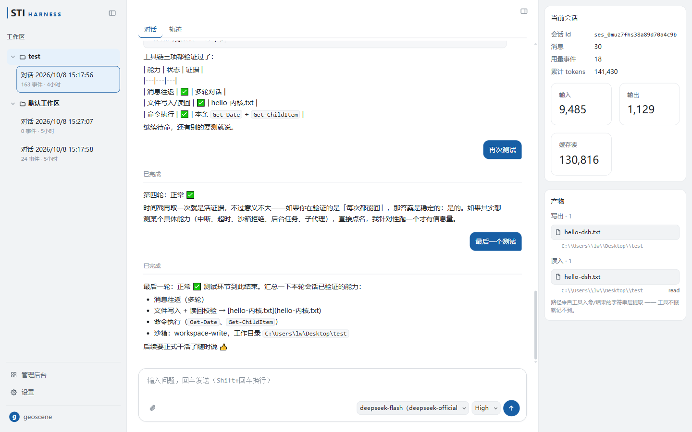
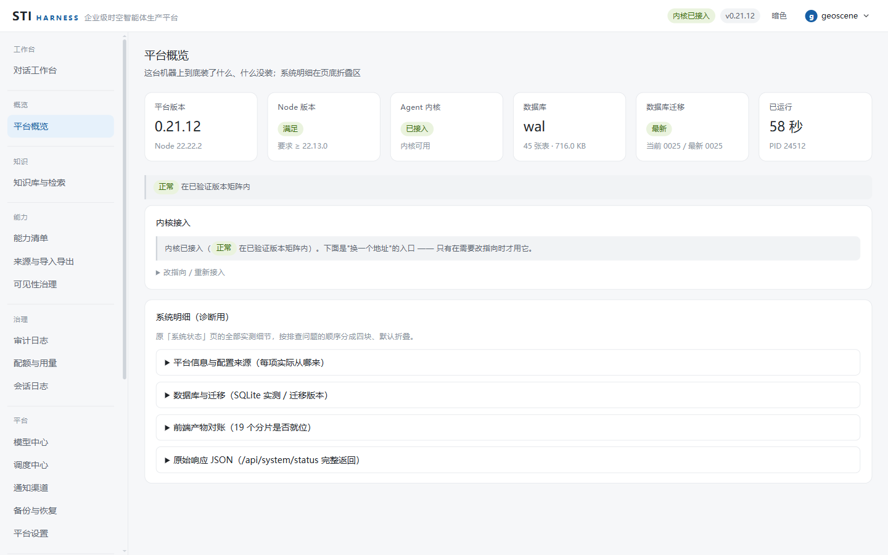
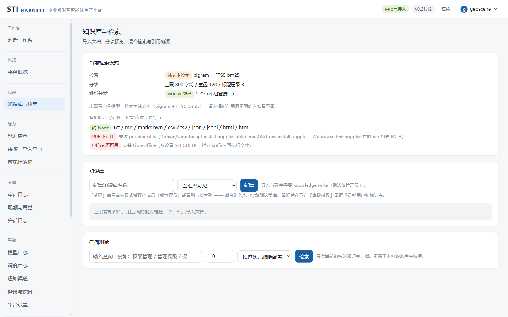
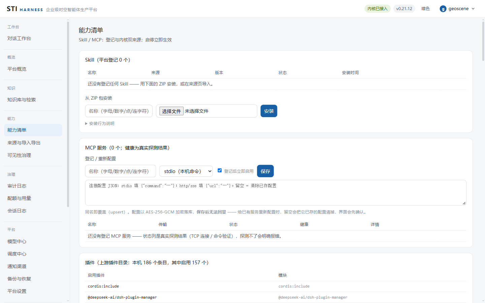
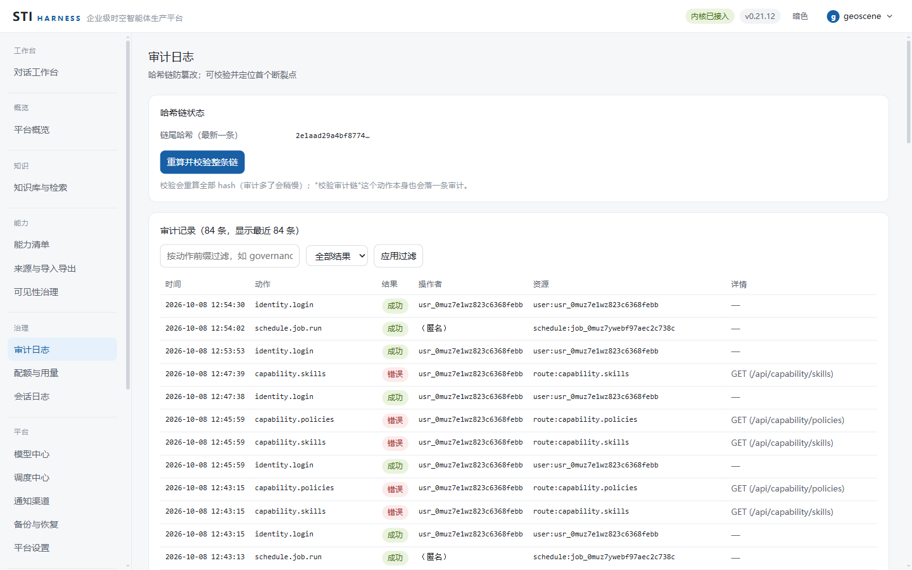

# STI HARNESS · 企业级时空智能体生产平台

> 基于 DeepSeek Harness（DSH）Runtime，面向企业内部可私有化部署的 Agent 生产平台。
> **单机单进程优先，零第三方依赖，渐进式 Node 演进。**

---

## 1. 一句话定位

**DSH 负责智能体如何运行，STI HARNESS 负责智能体如何进入企业生产环境。**

在 DSH 的会话、Skill、工具、MCP 能力之上，补齐四件企业必需品：

| 能力域 | 内容 | 交付状态 |
|---|---|---|
| **身份与权限** | 组织 / 用户 / 角色、登录鉴权（含 **TOTP 两步验证**）、资源级权限（含知识库级 ACL）；**部门**（组织归属，0.17.0 起可改名 / 删除）；**SSO / LDAP** | ⚠️ **部分** ↓ |
| **企业知识与检索** | 文档解析、分块、向量化、FTS5 + 向量混合检索、引用溯源、知识库隔离、**接入对话（会话挂载知识库，0.14.0）** | ✅ 已交付 |
| **治理与审计** | 审计日志、配额与用量、执行过程可追溯与产物留存 | ✅ 已交付 |
| **能力分发** | Skill / 工具 / MCP 的市场、安装、启停、版本更新、可见性治理 | ✅ 已交付 |

> **「交付状态」这一列是为了让人一眼分清「已交付」与「没交付」，不把两者读成一体。**
>
> | 状态 | 含义 |
> |---|---|
> | ✅ 已交付 | 有路由、有界面、有回归，**能真的用** |
> | ⚠️ 部分 | 主体可用，但有**明确标注**的缺口 —— 见下面这条 |
> | ❌ 未实装 | **刻意不做**（有理由），不是"还没轮到" |
>
> - **身份与权限 = ⚠️ 部分**，一处**明说的缺口**：**SSO / LDAP 如实不实装** ——
>   部门级内网用不上，引入它要牵进证书 / 目录服务的运维负担（理由与结论见
>   [`docs/roadmap.md`](docs/roadmap.md)）。
>   **部门**已从"能引用、不能创建"的半成品**补齐为可用**（0.11.1）：可创建、可列出（含真实成员数）、
>   可调整用户归属；**0.17.0 起支持改名与删除**（删除带**引用护栏** —— 先清成员、再删空子部门，
>   不制造悬空引用）。它有一条**明说的边界**：**部门不是权限载体** ——
>   把它当成"把谁挪进管理员部就有权限"是误解，权限只来自角色与用户组。
>   登录另可选开 **TOTP 两步验证**（0.17.0；一次性恢复码；**未开启者登录路径逐字不变**）。

### 界面一览

下面这些图取自**真实运行的本平台**（不是设计稿）：`node app/main.mjs` 起服务后，
用零依赖的 CDP 脚本登录并逐页截图。每一张都能在本地复现 —— 图里的数字来自真实接口与真实库。

| 对话工作台 | 平台概览 |
|---|---|
|  |  |
| 像用聊天工具一样提问；正文与「轨迹」分两个视图 —— 工具卡 / 推理 / 用量在轨迹侧，**聊天侧只留正文**。 | 这台机器上到底装了什么、什么没装；取不到的直接显示空态与原因，不拿占位数字凑。 |

| 知识库与检索 | 能力清单 |
|---|---|
|  |  |
| 导入 → 分块预览 → 混合检索 → 引用溯源；知识库可挂到会话上（RAG 闭环）。 | Skill / MCP 双来源对账；启停**立即生效**（能力闸在契约层就把它摘掉，无缓存、不重启）。 |

| 审计日志 | 配额与用量 |
|---|---|
|  |  |
| 哈希链防篡改；可校验并**定位首个断裂点**，而不是笼统地说"校验失败"。 | 先检后放行；数字全部来自真实 `usage` 事件，与事件流逐字段可比对。 |

> 📌 更多界面：`docs/images/` 下还有可见性治理、模型中心、调度中心、备份与恢复、
> 平台设置、账号 / 角色、契约与映射、接口清单等页的截图（同一批采集）。

### 快速开始

```bash
# Windows：双击 start.cmd
# Linux / macOS：
./start.sh

# 只做部署自检、不启动服务（服务在跑也能安全执行）
./check.sh
```

然后浏览器打开 **http://127.0.0.1:3090**（不要直接双击 `public/index.html`）。

首次打开会进**初始化向导**：建组织 → 建所有者账号 →（可选）配一个模型凭据。之后就是登录页。

前置条件只有一个：**Node.js ≥ 22.13**（`node:sqlite` 解禁）。
不需要 Docker、不需要 `npm install`、不需要外部数据库。空库到可用状态一条命令完成。

详细部署、配置、备份、排障见 [`docs/deploy.md`](docs/deploy.md)。

---

## 2. 设计取向

本项目**不是从零起意**，它的形状由两条各自独立的输入决定 —— 一条来自**工程直觉**，
一条来自**架构纪律**。两者分工明确，且都只取其中一部分：

| 输入 | 取什么 | 不取什么 |
|---|---|---|
| **工程直觉**（同权利人早期自研作品的经验） | 全部工程基因：零第三方依赖、单机双击即用、路由单点定义、统一重绘铁律、诚实数据源（取不到就空态，绝不假装在线）、零依赖回归脚本体系 | 单体脚本的分层方式（需拆模块）；用 `.json` 文件当状态存储（改 SQLite） |
| **架构纪律**（业界 Agent 平台的开源实践） | **架构思路**：契约优先（`AgentKernelContract`）、Runtime 与产品层解耦、上游兼容代码集中隔离、治理与审计是一等公民、统一网关、能力分发 | 技术栈与部署形态：不引入 Vue3 / FastAPI / MongoDB / Redis / 向量库，不做多容器 Compose |

> **关键结论**：值得借鉴的是**架构纪律**（契约优先 + Runtime 隔离 + 兼容代码收口），
> 不是任何一套技术栈。把纪律拿过来，用零依赖 Node + 内嵌 SQLite 实现同等能力，
> 既拿到企业级架构，又保住「双击即用」的部署优势 —— 这两件事在多数同类项目里是**对立**的，
> 本项目存在的理由就是证明它们可以不对立。
>
> ⚠️ **界线**：本项目**只借鉴思路，不复制任何外部代码**。本项目全部源码为本权利人独立实现，
> 第三方与参考来源说明见 [`NOTICE`](NOTICE)。
>
> 📌 **可行性评估见 [`docs/feasibility.md`](docs/feasibility.md)**——含实测证伪的假设、
> 能力缺口清单、风险矩阵、DSH 升级影响面与部署打包方案。

---

## 3. 四条设计原则（不可违反）

1. **零第三方依赖。** 只用 Node 内置模块。唯一可能的破例是数据库驱动，且必须先有空缺才能破例（见 `docs/architecture.md` 的驱动抽象）。
2. **单进程、双击即用。** 不装 Docker、不建 `.env`、不跑 `npm install`。企业能力在单进程内实现，而不是靠多容器堆出来。
3. **契约优先，DSH 只是 provider。** 产品层与前端**不直接消费 DSH API**；所有 DSH 依赖走 `AgentKernelContract`，DSH 专属代码只允许存在于 `app/kernel/dsh-provider/`。
4. **不落第二份数据，不造假数据。** 页面上的每个数字都来自数据库、DSH 实时接口、本机文件系统或真实探针。取不到就显示诚实的空态。

---

## 4. 技术底座（已在本机实测验证）

以下能力全部用 Node 内置模块实现，**无需任何第三方包**：

| 需求 | 内置方案 | 实测结论 |
|---|---|---|
| 业务数据库 | `node:sqlite`（`DatabaseSync`） | ✓ 可用（Node 22.22 / 24.10 均通过） |
| 全文检索 | SQLite **FTS5** 虚拟表 | ✓ 可用，`CREATE VIRTUAL TABLE … USING fts5` 成功 |
| 全文检索（中文） | **bigram 预处理** + FTS5 | ⚠️ 实测：unicode61 对中文**按整段作一词**，子串检索 0 命中；trigram 对 2 字词 0 命中。**必须 bigram 预处理**，见 `docs/feasibility.md` §1.2.1 |
| 向量检索 | `Float32Array` 存 **BLOB** + 余弦相似度 | ✓ 写入 / 读回往返一致，12 字节 = 3×float32 校验通过 |
| JSON 字段 | SQLite **json1** 扩展 | ✓ `json_extract` 可用 |
| 并发读写 | SQLite **WAL** 模式 | ✓ 文件库可开启（内存库不适用） |
| 口令哈希 | `node:crypto` **scrypt** | ✓ 内置，无需 bcrypt |
| 会话令牌 | `node:crypto` **HMAC-SHA256** + `randomUUID` | ✓ 内置，无需 jsonwebtoken |
| 凭据加密 | `node:crypto` **AES-256-GCM** | ✓ 内置 |
| 后台任务 | `node:worker_threads` | ✓ 内置，用于解析与向量化 |
| 自动化测试 | `node:assert` + **自研极简 harness** | ✓ 零依赖。**刻意不用 `node:test`**：它的报告器刷新时机无法保证「末行输出 `DONE fails=N`」这条项目约定 |
| 压缩导出 | `node:zlib`（brotli / gzip） | ✓ 内置 |
| 实时流 | **自研 WebSocket 字节管道桥** | ✓ 内置 `node:http` upgrade + `node:crypto` 帧掩码，无 `ws` 依赖 |

**依赖底线**：Node ≥ 22.13（`node:sqlite` 解禁），推荐 Node 24。上表在 Node 22.22.2 / 24.10.0 实测通过。

> ⚠️ `node:sqlite` 目前仍是 experimental 状态（Node 22 上会打印 `ExperimentalWarning`）。
> 缓解措施见 `docs/architecture.md` 的「数据层驱动抽象」一节。

---

## 5. 目录结构

> 这份树描述的是**已经建成的结构**（不是规划稿）—— 每一项后面都注明了它属于哪一版。
> 它与磁盘是否一致，由 `node tools/audit-orphans.mjs` 兜底（模块可达性 + 前端分片 ↔ `index.html` 对账）。

```
sti-harness/
├─ start.cmd / start.sh          # 单机启动器（环境自检 + 起服务 + 打印地址）
├─ check.cmd / check.sh          # 部署自检（等价 node app/main.mjs --check）
├─ VERSION                       # 版本号单点维护
├─ app/
│  ├─ main.mjs                   # 进程入口：装配依赖、优雅退出
│  ├─ config.mjs                 # 配置装配（env > config.json > 默认）
│  ├─ paths.mjs                  # 路径推导（全项目唯一允许出现"目录从哪来"的地方）
│  ├─ log.mjs / diagnostics.mjs  # 日志器 / 自检（项数现读 `node app/main.mjs --check`，别手抄）
│  ├─ http/                      # 路由表（单点定义）、静态托管、WS 桥、中间件链
│  │   └─ openapi.mjs            #   OpenAPI 3.0.3 规格**从路由表生成**（P1-3，纯函数）
│  │   └─ middleware/            #   context / ratelimit / auth / tenant / rbac / quota / audit 七项全部实装
│  │                             #   收尾钩子：finalizeAudit（有条件，只记状态变更）+ finalizeMetrics（无条件）
│  ├─ kernel/                    # ★ 契约层
│  │   ├─ contract.mjs           #   AgentKernelContract 定义 + 事件归一
│  │   ├─ dsh-provider/          #   上游专属适配器（唯一允许碰上游的地方）
│  │   └─ unconfigured-provider.mjs  #   未接入时的占位 provider（所有方法抛 kernel_not_configured）
│  ├─ data/                      # SQLite 连接、版本化迁移、仓储、主密钥
│  │   └─ migrations/            #   0001 建表 + FTS5 … 0019 两步验证
│  │                             #     （完整清单现读 app/data/migrations/，**别手抄** —— 这里曾停在 0012）
│  ├─ platform/                  # ★ 八个平台模块
│  │   ├─ identity/              #   身份与权限（M1）：口令 / 令牌 / 权限 / 凭据 / 仓储 / 服务 / 两步验证（TOTP，0.17.0 起）
│  │   ├─ governance/            #   治理与审计（M3 + P1-2 + P1-3）：哈希链 / 归档与链基准 / 配额（含并发闸）/ 成本核算
│  │   ├─ knowledge/             #   ✅ 企业知识与检索（M2 + P1-2）：
│  │   │                         #   parsers/（md/txt/csv/json/html 纯 Node + PDF/Office 外部命令）
│  │   │                         #   chunker.mjs（标题/页边界 + 重叠）/ embedding.mjs（可降级）
│  │   │                         #   retrievers/（FTS5 bm25 + 暴力余弦 + RRF 融合）/ repos/ / service.mjs
│  │   ├─ capability/            #   能力分发（M4）
│  │   ├─ operation/             #   备份与校验（M5）：service.mjs 门面；刻意不暴露 restore
│  │   ├─ model/                 #   模型中心（P1-1）：配置 / 探活 / 默认与降级链，**不做转发**
│  │   ├─ schedule/              #   定时任务底座（P1-2）：规则解析 / 到期扫描 / 执行体白名单
│  │   ├─ notify/                #   出站通知（P1-2）：事件白名单 / URL 加密 / SSRF 校验 / 尽力投递；**0.13.0 起有产生方与 10 分钟合并窗口（producers.mjs）**；0.17.0 起含企微 / 钉钉信封
│  │   └─ observe/               #   指标（P1-2）：进程级计数器与 Prometheus 文本渲染（旁路，不做门禁）
│  ├─ worker/                    # ✅ worker_threads 池（M2 启用；拿不到线程时内联并如实标注）
│  └─ util/                      # ids / errors / bigram（中文分词）/ quiet-warnings
├─ public/                       # 前端（boot.js 首屏引导 + index.html / style.css + app/ 下按域分片的前端代码）
├─ tools/                        # 零依赖回归与审计脚本
│  ├─ gate.mjs                   #   ★ **开发 / 测试入口只有这一个**（0.13.1）：按固定顺序跑完全部检查
│  │                             #     （项数现读 `node tools/gate.mjs --list`，**别手抄**），
│  │                             #     末行给 `GATE DONE checks=<通过>/<总项> skipped=… fails=…`；
│  │                             #     它**同时打印"这个门禁测不出什么"**，免得把"没测"读成"没问题"。⚠️ 判据是
│  │                             #     "退出码 0 **且** 找到约定末行 **且** 末行数字是 0"三条同时成立 ——
│  │                             #     只看退出码会把"脚本没跑到末尾（= 什么都没检查）"读成"通过"
│  ├─ test-core.mjs              #   核心回归（266 用例：纯函数 / 权限矩阵穷举 / 解析分块 RRF / ZIP / 调度通知指标 / OpenAPI / 成本口径 / 知识库级 ACL（含授权主体校验与校验顺序）/ 向量预过滤三态 / 部门 / 通知重投队列 / 备份告警产生方与自检 [14] / **0.15.0 自检 [15]：明文令牌落盘三态（独立的明文键 / 地址内嵌 / 已封存）** / 0.13.0 配额拦截的产生方与节流 / 0.14.0 知识注入的跨端契约（服务端标记 ↔ 前端形态识别，一次切干净）/ **0.15.0 内核接入向导（地址归一化 / 配置合并 / 诊断文案 / 待重启对账）+ 探测分类对着真实 HTTP 桩 + 运行期抹名（上游名不许随字符串穿到界面）+ 用量取数规则（挂在助手消息上的用量也要记账，且与汇总同一条规则）** / **0.15.1 中文查询四级阶梯（整句切段后段间 AND 不再判死整条查询）+ assistant/message 事件按上游块类型拆 reasoning 与正文** / **0.17.0 两步验证（TOTP：RFC 6238 向量 / 防重放步号 CAS / 恢复码一次性 / 未开启者登录逐字一致）与 CSV 批量导入（逐行独立 / 上限先于哈希）+ 部门改名删除护栏 + 删账号清 TOTP 三表** / **0.21.0 工作区三档判定（五条优先级的顺序表穷举 × 四档 × 可见性 / 批量过滤按 scopeId 分组不聚合 / 可见性规范化 / 迁移 0021 的列与默认档）**〔0.21.6 那套模块整块删除后，这几条改写成：**档位推导 `levelFromRoles`（含 fail-closed）+ 档位比较 `levelAtLeast` + 迁移 `0023` 生效** —— 钉的是「`workspaces` 已经**没有** `visibility` 列」而不是「默认值对不对」，否则 0023 被回退时会静默通过〕 / **0.21.4 内核两态（`selectKernel` 只按"配置里有没有地址"分叉：没地址 → 占位 provider，**每个契约方法都抛 `kernel_not_configured`、绝不返回"看起来正常的空结果"**；有地址但连不上 → 如实报不可用）＋ 版本门禁穿过**真实 provider** 而不是字面量（"没有上游版本时不得报出『上游版本未验证』"——从前靠"内核模式 = mock 就跳过门禁"盖住，模式删了就得由 provider 自己如实报空）＋ 迁移 0022 删掉 `agent_sessions.kernel` 列** / **0.21.5 待重启判定只剩地址一个客观量（"模式"这个概念整个消失）**）
│  ├─ test-unit.mjs              #   快速单测层（36 用例，<1s）：**无 IO 纯函数**的毫秒级回归（入参校验器 / 中文切词与查询阶梯 / 归一化 / 算钱口径 / **0.19.0 模型目录 provider 按 id 前缀推导规则**）—— 改一行纯函数不必付端到端的几十秒；两层各管各的：这层钉"函数语义"，端到端钉"装配与协作"
│  ├─ test-http.mjs              #   HTTP 端到端回归（125 用例，自带临时库 + 随机端口；含库级授权的 404 / 403 分离、**0.15.0 内核接入两条路由（探测 / 保存，含"检测没通过就 409 且带回完整诊断"、老客户端再传 `force` 也一样被拒）与"代表性接口响应体里不得出现上游产品名"的运行期扫描** / **0.16.0 平台设置 GET / PUT（env 覆盖键 400、类型强转与范围校验、保存后实时回显）与配额编辑 PUT** / **0.17.0 CSV 批量导入（逐行独立 / 只读 403 / 审计 via=import）+ 会话导出（md 与 json 同一事实、注入段剥离并注明、400 / 404、留痕）+ 两步登录 wire（真 HTTP 两步 / 恢复码 / 管理员重置）** / **0.18.0 三条新路由进路由表（Skill 卸载 / 文档改名 / 备份删除 —— 备份删除连声明面 method/scope/capability 逐字段断言）** / **0.21.0 工作区树与三档权限（CRUD / 可见性 / 三档 / 会话归位 / 模式与推理等级）：用两个**不同全局角色**的探针（viewer 与 member）——只用一个 viewer 验到的是路由层 RBAC，请求根本走不到档位判定那一层；钉住「挡住 view/write 的分别是哪一层（RBAC 给 detail.needs，工作区层给人话档位名）」、「删工作区不级联（detachedSessions 计数 + 会话仍在）」、「模式与推理等级落库后回读」、「workspace.* 动作全部留审计」；另修掉运行期抹名扫描的一处**假红**（随机 id 里的 `dsh` 三个字母，改成词边界匹配）** / **0.21.6 工作区权限整块删除：**三条反向断言** —— 路由表里工作区恰好 4 条且 `workspace.grants.*` 不许回来、树不再下发 `levelLabels`/`grantRoles`/`myLevel`、授权端点对**管理员**也 404；**member 改工作区必须是 403 而不是 404**（「看不见就 404」那条随可见性一起删了，这两者的区别只有反向断言钉得住）；全组织可见（viewer / member 都看得见里面的会话，读它是 200）；`canManage` 仍用正反对照（member 对自己的 true / 对别人的 false；admin 对别人的 true —— 同一条会话两个角色两个结论，不这样对照「一律 false」也全绿）；默认工作区里要有**落脚会话**且播种幂等（独立租户二次调用不再补、`workspace.default.seed` 与 `session.default.seed` **各恰一条**）** / **0.21.1 判定同源与默认工作区：列表回显 `canManage` 用**正反对照**钉住（`view` 档 false → `write` 档"自己的 true / 别人的 false" → `full` 档 true；未分组 `manageNeed: null`）——只测一边在"一律要 full"的实现下照样绿；默认工作区播种（独立租户幂等 / 二次调用不改 `cwd` / 审计**恰一条** `workspace.default.seed`）；初始化向导走完即有一个能立刻用的默认工作区（`cwd` 形态 `.../workspace`、`visibility: 'open'`、`myLevel: 'full'`、`ownerUserId` = 建组织的那个人）** / **0.21.3 内核热切换（保存即生效）：两条钉子都必须**观测门面本身**（读 `kernel.ready` / `kernel.dshStatus`）而不只是读响应体 —— 响应体可能只是把请求里的配置回显了一遍，那正是"热切换"的第一种假货；① 保存一个可达地址 → `restartRequired:false`、`kernel.ready` 当场变 `true`、`status.restart.pending` 变 `false`（旧行为里这句恒真，它必须**有能力变假**）；② 目标连不上时**照切**（直接驱动装配层：0.21.5 删掉 `force` 之后这条路径走不到 HTTP 口了）—— 从前那段"会降级所以先不切"的保护判断，保护的是**已删除的内置内核**；保护对象没了，剩下的只有"保存什么就是什么"；另钉住 env 覆盖时仍报 `restartRequired:true` —— 不许因为支持了热切换，就对"文件改了、进程没变"这种情形也谎报已生效。**本版最大的坑在装配层**：新增 deps 能力 `switchKernel` 时测试脚手架没注入，接口会**如实降级**成"需重启"，于是"保存即生效"这条路径在回归里**静默测不到**（断言照样全绿）—— 少接一根线不会报错，只会让断言测了个寂寞** / **0.21.4：`/api/health`、`/api/system/status`、`/api/kernel/status` 一律报 `ready` 布尔，不再有 `mode`；「保存连不上的地址」的钉子改成**直接驱动装配层**（0.21.5 删掉 `force` 后走不到 HTTP 口）** / **0.21.5：保存口**只认"检测通过"** —— 非 ok 一律 409 且带回完整诊断，老客户端再传 `force: true` 也一样被拒（顺便钉住"别把这条旁路加回来"）；写盘仍会顺手清掉老配置里的 `kernel` 键**）
│  ├─ test-knowledge.mjs         #   知识层端到端（34 用例：中文召回 / 引用链 / 降级 / 重试与重建）
│  ├─ test-frontend.mjs          #   前端行为回归（226 用例 / 录制 148 条：起真实服务录响应 → vm 里**逐片**真跑 public/app/*.js，分片清单现读 index.html，含事件委托派发与工作台最后一公里；**0.13.0 `App` 成员跨片解析**；**0.14.0 知识注入标记契约对账** / **0.16.0 行内出口钉（MCP 登记 / 删账号 / 模型编辑 / 会话改名删除 / 配额编辑 / 绑定切换）+ 内联样式护栏（基线 129）** / **0.17.0：TOTP 登记与两步登录 UI、部门改名 / 删除弹层（含取消不发请求）、CSV 导入弹层（口令不回显）、会话导出按钮（流式中禁用）** / **0.18.0：用户组改名 / 用户姓名编辑 / 调度任务行内编辑 / 通知渠道行内编辑 / 会话日志 log.zip 下载 / Skill 卸载 / 知识文档改名 / 备份删除（弹层护栏与权限收敛）** / **0.19.0：工作台「可用能力」面板四段（差距行与无工具清单 RPC 如实标注）、助手正文安全 markdown 子集渲染（`javascript:` 退化 / 原始 HTML 字面）、工具卡 JSON 富格式** / **0.20.0：工作台「实际调用」面板与工具卡来源对账三态（登记 / 仅探测到 / 未登记，钉住"不按名字前缀猜 MCP"）、能力清单页与来源页的工具登记表双来源（含假差距不许渲染）** / **0.21.0：工作台左栏改工作区树（工作区 → 会话 → 「未分组」）、输入卡选择器（模式 / 推理等级）、没有会话时的品牌空态页、工作区增改删与会话在工作区之间移动的动作接线（含树过滤与折叠）** / **0.21.1：管理动作收进行内「⋯」（菜单是**状态**不是 DOM 浮层 —— 展开后才有入口、一次只开一个、点空白收起、不误触外层行；浮层的定位/遮挡在 vm 层测不到）、工作区行「＋新会话」建在**那一行**、未分组桶只摆「新建」、模型与推理等级同排到输入卡**（其中「工作目录…」真实发 PATCH、`view` 档禁用写明档位、「工作区权限…」按**所在工作区**解析后展开三条断言，**0.21.6 已随对应动作一并删除**）** / **0.21.2：工作台改**全屏视图**（有品牌头、无管理顶栏 / 无页标题）、输入卡新结构（徽片行在卡外、模型与等级与圆形发送钮在 `.wb-card-foot` 内且 `#wb-model` 恰一个）、空态不渲染噪音条（知识库条 / 附件条 / 消息流）、过滤器 / 检索栏 / 右栏**默认收起**（用例须先显式展开）、未分组空桶不渲染、以及**全屏工作台自带登出入口**（顶栏已不在 —— 这条钉的是真机层抓到的真缺陷）** / **0.21.4：未接入内核时的**整页阻断**（`pageKernelGate`）—— "每个渲染分支都必须拼 `dlgOverlay()`"这条不变式多了一个成员；`sessionStorage` 从 vm 沙箱里删掉（"记住本会话关过引导"那个机制随可关闭弹窗一起没了，留着它只会让下一个"没声明的全局"静默通过）** / **0.21.5：接入弹框收敛成**一屏**（那些"不许长"的断言钉的是它 —— 四五屏说明文里"填地址、点检测"会被淹掉）；**检测没通过就不能保存**（本地拦住不发请求 + 服务端 409 兜底）；**改动输入即作废上一次的检测结论**（否则"先探个好地址再改成另一个"就是绕过检测的路）；**保存成功当场关闭弹框并落到落地页**（判据用 `switched.ready` 而不是"请求返回了 200"） / **0.21.6：左栏结构收口与工作区权限整块删除 —— ①**工作区行行尾的两个动作恒在 DOM 里**（显隐是 CSS 的 hover，不是条件渲染：真机层只能靠 hover 让它们现身，DOM 里没有就等于功能没做），顺序是 `⋯` 在左、`＋` 在右；②**权限模块的删除用双向反向断言钉**：8 个已删动作 `typeof App[x] === "undefined"` **且**渲染结果里没有对应 `data-act`，两个菜单里不许出现「权限」字样，前端一次都不请求工作区授权名单（`/api/workspaces/:id/grants` 那种形状 —— 知识库的 ACL 是另一码事，不算在内）；③左栏顶部「新会话」胶囊与「插件」入口已删、输入卡上方没有 `#wb-ws`、没有 `wb-level-chip`（这类删除最容易做成"藏起来"，而藏起来的那份会一直在）；④行尾「＋」在没有 `session:write` 时是**禁用并写明原因**的态（权限矩阵是**布尔对象**，写成数组会把 read 也抹掉 → 落地页直接回落到概览，测到的是另一个页面）** / **0.21.7 界面收口：删会话内检索与清屏（反向断言：`typeof App.wbRunSearch === "undefined"`、`wbReset` 也没有、输入卡上方找不到 `#wb-q`，且 `wbToggleRail` 之外右栏不再有第二颗钮）、删归因徽标并把"选中的"与"绑定的"并成一件事（三条：选择器即绑定项 / 打开会话时按选择器补绑 / 补绑失败**静默**）、删右栏「实际调用」与「可用能力」两段（改成"工具卡各带来源徽标"正面 + 右栏那两块的反向断言；`wbAttributeTool` / `wbCatalog` 与 `w.caps` 拉取仍在）、图标一律内联 SVG（`svg.wb-ico`，并把 `📁 演示工作区` / `⚙ 标准模式` 这类字符断言改成结构断言 —— 按符号断言下次换图标又得改一遍）、新增的 `Dlg.browse` 目录选择器三态（逐级选 cwd / `''` 是有效选择 / `null` 是取消 / **路径还没读出来就点确定必须拦住**，否则空串会被当成"没给 cwd"、静默建出一个没有工作目录的工作区）；另有一组直接读样式表的钉子：**展开钮不许住在 `<aside class="wb-side">` 里**（住进去就会被 `display:none` 一起藏掉）、`.wb-sec-tools` 收着用 `opacity:0` 而不是 `display:none`（后者会让按钮**从 Tab 序列里消失**）且必须配 `:focus-within`、`--wb-compose-w` 必须是**纯长度**（写进 `calc(100%)` 会在两个不同父元素上解析出两个值，"同宽"根本不成立）且空态下 `.wb-stream` 里不许有子节点**）
│  ├─ test-governance.mjs        #   治理层端到端（59 用例：审计链 / 配额 / 产物 / 备份闭环 / **MCP 启停与注销** / **0.18.0：Skill 卸载（zip 删目录 / 非落盘与越界只注销 / 审计恰三条）+ 文档改名（不重新解析）+ 备份删除（末份 409 / 形态白名单）**）
│  ├─ test-stream.mjs            #   回合流式回归（24 用例：NDJSON 帧序列 / 中途失败 / 用量归集）
│  ├─ test-browser.mjs           #   ★ 真机浏览器验收（23 场景，0.15.3 引入、0.17.0 增补：零依赖 CDP 驱动本机 Edge/Chrome 无头实例，
│  │                             #     setup→登录→22 页逐路由扫荡→组织身份 / RAG 闭环 / 治理 / 运维四条业务流
│  │                             #     + UI 不变式四则（窄视口右栏可达与开合 / 对话框 Tab 焦点陷阱 / 侧栏滚动位置跨重绘保持 /
│  │                             #       工作台收口：左栏收起后可展开 · 节头划过显形 · 正文与输入卡同轴）
│  │                             #     + 全局异常对账（放最后，此前全部场景的未捕获异常一并对账）；
│  │                             #     真实 DOM/JS 是 vm 层的结构性盲区 —— 0.15.1 取消语义、0.15.0 挂库不刷新、
│  │                             #     0.14.2 侧栏键盘、0.15.3 createJob/createChannel 表单丢失全是这类；
│  │                             #     **0.21.1 又抓到一次同类**：改名按钮收进会话行的「⋯」后，
│  │                             #     "等 [data-act=wbRenameSession] 出现"必然超时 —— 入口在**菜单里**，
│  │                             #     要改的是交互路径（先点 ⋯）而不是超时时间；vm 层只验"HTML 里有没有它"，
│  │                             #     只有真机层会真的去找它、点它。
│  │                             #     **0.21.2 抓到的是一个真缺陷（不是用例写错了）**：工作台改成全屏视图后
│  │                             #     不再渲染顶栏，而「登出」此前**只存在于顶栏** —— 进了工作台就再也登不出去。
│  │                             #     一条用例把身份换错，后面十几条会集体假红，而错误信息只会说"选择器没找到"；
│  │                             #     为此 `t()` 在失败时打一份现场快照（hash / 视图 / 登录是谁 / 外壳元素），
│  │                             #     并可用 `STI_BROWSER_TRACE=1` 打开逐场景身份轨迹 —— 先排登录态，再排渲染。
│  │                             #     **0.21.7 补的三条都是 vm 层的结构性盲区**：布局（展开钮收起来之后是否真的
│  │                             #     可见、可点、落在视口里）、CSS `:hover`（`br.click()` 发的是 JS 合成 click、
│  │                             #     `isTrusted=false`，浏览器不触发 hover 伪类 —— 必须走 CDP
│  │                             #     `Input.dispatchMouseEvent` 发真实指针移动，再读 computed opacity）、
│  │                             #     几何（正文列与输入卡的左右边缘差几像素，vm 层连盒子宽度都算不出来）。
│  │                             #     ⚠️ 另记一条写用例本身的坑：**模板字符串里的注释不许出现反引号** ——
│  │                             #     它会把模板提前闭合、后面的文本被当成 JS 解析，报出一个与现场毫无关系的
│  │                             #     `ico is not defined`（排查时先看报错所在的那一行是不是注释）。
│  │                             #     **找不到浏览器则如实 SKIP，不计入通过**）
│  ├─ test-external.mjs          #   ★ 外部内核端到端（12 用例；上游不在场则如实 SKIP）
│  ├─ test-external-stream.mjs   #   ★ 外部内核的**增量到达**（真上游下的流式；无上游则自报 SKIP）
│  ├─ kernel-stub.mjs            #   ★ 回归用的**确定性内核替身**（0.21.4 从 app/kernel/ 移到 tools/）
│  │                             #     只被测试脚手架**显式注入**（`createKernel({ provider: createKernelStub() })`），
│  │                             #     产品路径永远走不到它 —— 没配地址就是"未接入"，没有可降级的本地内核
│  ├─ verify-upstream.mjs        #   ★ 对运行中的上游核实方法名与参数形状（升级后必跑）
│  ├─ bench-search.mjs           #   检索性能基准（P50/P95 + 预过滤对照的延迟与召回损失，写入 docs/benchmark.md）
│  ├─ bench-concurrency.mjs      #   并发与长稳基准（吞吐 / P95 / 错误率 / 内存 / 事件循环滞后；**开环定速须配 `--open-sender=process`**，写入 docs/benchmark-concurrency.md）
│  ├─ bench-scenarios.mjs        #   基准场景定义（主进程与**独立发包端**共用同一份，否则两边压的不是同一个东西）
│  ├─ audit-layering.mjs         #   分层审计（上游概念是否泄漏到产品层）
│  ├─ audit-tenant-isolation.mjs #   多租户隔离静态扫描（隔离表清单从迁移事实生成）
│  ├─ audit-orphans.mjs          #   ★ 模块孤儿 + 断链 import + **前端分片 ↔ index.html 双向对账**（0.13.1）
│  ├─ audit-coverage.mjs         #   ★ 覆盖对账（0.15.3）：22 页 × vm/浏览器双层锚点 + 143 个 API × 测试语料引用，
│  │                             #     「全功能可用」不再是口头承诺 —— 漏网即红（白名单 1 条，必须写明理由）
│  ├─ pack-release.mjs           #   白名单打包 + 打包即扫描（条目名 ＋ 凭据形态 ＋ 令牌形态三重扫描，
│  │                             #     令牌那一重覆盖 app/ + public/ + tools/ + docs/ —— 凡随包出去的目录都扫；
│  │                             #     0.15.0 起它本身也是门禁第 14 项 `packscan`）
│  ├─ restore-backup.mjs         #   离线恢复（防误覆盖 + 恢复后 integrity_check 自证）
│  ├─ adopt-data-dir.mjs         #   把非规范命名的库文件采纳成规范名（0.10.1 更名后的升级通道，只复制不删原件）
│  ├─ seal-kernel-token.mjs      #   ★ 把老配置里**明文的内核令牌**就地封成密文（0.15.0）
│  │                             #     默认只报告；`--apply --force` 才写（写前备份，写后往返校验）
│  │                             #     为什么需要它：0.15.0 之后写的都是密文，但**在那之前写下的配置
│  │                             #     不会自己变**；明文那个形状不报任何错，却会随备份包一起被带走
│  ├─ record-fixtures.mjs        #   真实上游事件流录制（脱敏）
│  └─ snapshot-upstream-contract.mjs  #   上游类型契约快照比对
├─ docs/                         # 架构 / 路线图 / 可行性 / 部署 / 性能基准；**文档地图与单一真相源见 docs/README.md**
└─ data/                         # 运行时数据（库、上传、主密钥）—— 不入版本库
```

> 📌 **开发 / 测试入口只有一个（0.13.1 起）：`node tools/gate.mjs`。**
> 它按固定顺序跑完上面全部检查（部署自检 + 主回归 + 静态审计 + 2 个"要真上游"的外部验收），
> 末行给出一行可核对的结论；换机器、换人、半年后再回来，跑的是同一份清单 —— 清单就写在脚本里。
> 只想跑其中几项：`node tools/gate.mjs --only=core,http`；只看清单：`--list`。
> ⚠️ 它会**如实打印"这个门禁测不出什么"**（多机压测、长稳、真上游对话、浏览器里的布局 / CSS / 真实鼠标轨迹与多标签并发、TLS 边界），
> 并且 **SKIP 不算通过** —— 无上游时那两项记 `~`，不计入 `checks=<通过>/<总项>` 的分子。
> ⚠️ 这些脚本**各跑各的进程、各起自己的临时库与随机端口**，可以单独执行；
> `gate` 只是顺序与判据的**单点定义**，不是新的运行容器。

---

## 6. 首期范围

首期目标是**一个大版本内落地四项能力**，分为六个里程碑（详见 `docs/roadmap.md`）：

| 里程碑 | 内容 | 状态 |
|---|---|---|
| **M0** | 骨架：进程装配、路由表、SQLite + 迁移、自检、单机启动器、契约层就位 | ✅ **已完成**（5 项验收全通过，含补齐的 fixtures 回归） |
| **M1** | 身份与权限：组织/部门/用户/角色、登录、scrypt、HMAC 会话、RBAC、凭据加密 | ✅ **已完成**（0.2.0，5 项验收全通过；99 个回归用例） |
| **M2** | 企业知识与检索：解析、分块、FTS5 + 向量混合检索、引用溯源、Worker 池 | ✅ **已完成**（0.3.0，5 项验收全通过；193 个回归用例） |
| **M3** | 治理与审计：审计日志、配额与用量、敏感操作审批、执行追溯与产物留存 | ✅ **已完成**（0.4.0，5 项验收全通过；产物留存已于 0.5.0 开头补做）。哈希链审计可查可验、配额 block/warn、审批队列、真实 usage 采集、治理前端三页 |
| **M4** | 能力分发：Skill / 工具 / MCP 清单、安装启停、可见性治理、导入导出 | ✅ **已完成**（0.5.0，4 项验收全通过；产物留存提前在 M4-0 补做）。三级 allow/deny 可见性（契约层清单 + 执行面双闸）、ZIP 安装失败即回滚、MCP 真实健康探测、脱敏导出/幂等导入、能力前端三页 |
| **M5** | 企业化收口：多租户隔离审计、备份恢复、打包、兼容策略 | ✅ **已完成**（0.6.0，4 项验收全通过 —— **五个里程碑全部交付**）。备份/校验/离线恢复闭环、多租户隔离静态+动态双审计、per-tenant 可见性两档语义、白名单打包+泄漏双扫描、升级兼容文档；SSO/LDAP 如实不实装（无目标客户环境） |

> ⚠️ **0.6.0 五个里程碑全部交付，但这不等于可以不做运维就放上网。**
> M3 交付的是「出了事能查、危险操作能拦」的治理层；M4 交付的是「能力是企业资产」的分发层 ——
> 但 **token 配额仍是软闸**（精确事前拦截要等 model gateway）、
> **审计链的"整表重写"要靠链尾锚点出站才防得住**（0.8.0 已提供锚点与 `audit.anchor` 事件，
> 但**必须把它配到外部渠道**才真正生效）、
> **per-tenant 可见性是保守并集**（`listTools({tenantId})` 才是精确判定）。
> 对外服务前必须按 [`docs/deploy.md`](docs/deploy.md) 配好 TLS 反向代理 —— 明文 HTTP 下 cookie
> 的 `Secure` 标记与 CSRF 判定都只能退化工作。

> ✅ **真实内核已打通（2026-10-01，P0-A）。** 此前 `docs/history/assessment-0.6.0.md` 指出的最大隐患 ——
> "真实 DSH 下建会话/发回合全部 501、回归却在 mock 下全绿" —— 已修复：
> 新增 `tools/verify-upstream.mjs` 逐条实测上游方法（发现并修正了 9 个错的方法名与参数形状），
> 垫片 `compat/0.2.0-rc.2.mjs` 的 `verified` 标记改由**实际调用**产生，
> 新增 `tools/test-external.mjs` 把"对话能不能用"变成一条断言。
> 实测：**12 用例全过**，一轮对话收集到 17 条真实事件（`turn-start`/`message`/`turn-end`）。
> 要接真实上游，先跑 `node tools/verify-upstream.mjs` 核实，再接
> `node tools/test-external.mjs` 验收。

> ✅ **P0 整段已完成（2026-10-01，P0-A/B/C/D）。** 除了上面的真实内核打通：
> - **回合流式化（P0-C）**：`POST + 分块 NDJSON`（不用 WS/SSE，理由见 `roadmap.md`），
>   服务端接上游事件流边收边推；实测真实上游 **首事件 +237ms / 收流 +646ms / 4 个分块**。
> - **用户对话工作台（P0-B）**：新增与后台并存的「工作台」壳（左会话 / 中对话流 / 右上下文），
>   首字逐帧渲染 + 工具卡 + 内联审批 + 模型切换；**登录后落地页就是它**，无 `session:read` 才退回概览。
> - **0.6.0 遗留小缺陷（P0-D）**：死配置 `sessionTtlHours` 接线、`approvals` 补 `tenant_id`
>   （修掉一处**静默跨租户越权**）、前端陈述更正、补备份页、**安全响应头**（CSP / HSTS /
>   `X-Frame-Options` / `X-Content-Type-Options`）。逐项说明与回归位置见
>   [`docs/roadmap.md`](docs/roadmap.md) § P0-D。

> ℹ️ **读下面这些版本块时先看这一条**：「发布产物」里的包名是**当时的编号**，
> 而且这几行记的是**当时产出了什么**，**不是当前 `dist/` 的清单**。
> 本项目在 0.13.1 把版本线从 `1.x` 整段重排回 `0.x`（对照表见
> [`docs/versioning.md`](docs/versioning.md) §3），但**已打出的包刻意没有改名** ——
> 改名等于篡改产物的出处。所以你会看到 `0.12.1` 这一版的产物叫 `1.6.0.zip`：
> 那是它当时**真的按那个号**打出来的。按 §3 的留存规则，`dist/` 里**只留最新一版**
> （清理并未逐轮执行，**以磁盘为准**）；本版是 `0.19.0`，按新编号打包。
> ⚠️ 这下面有一类**很难自查**的失真，0.13.1 收口时逐条拿 `dist/`（含改名前的备份）对账才查出来，
> 一共**三层叠在一起**，都已改回当时的真实包名：
> 1. **重编号把"引用包名"也换了号**：脚本改了字符串、物理文件没动，于是下面几张写着
>    `0.12.1.zip` 的地方，磁盘上是 `1.6.0.zip`。
> 2. **更早的 4 个包前缀不是 `sti-harness`**：`1.0.1`–`1.0.4` 是项目还叫 **`geoscene-harness`**
>    时打的（`1.1.0` 才是"全量更名 STI HARNESS"，见 [`docs/versioning.md`](docs/versioning.md) §3 对照表）。
>    字节数可以对上：`1.0.4` = **904079 B** ↔ 下面写的"约 90.4 万字节"。
> 3. 按 §3 的留存规则，`dist/` 里**只留最新一版**（清理并未逐轮执行，**以磁盘为准**）——
>    所以这几行是**当时产出的记录**，不是当前 `dist/` 的清单；本版是 `0.19.0`，按新编号打包。
> 为什么难查：**它看起来完全自洽**（版本号、条目数、字节数全都"对得上"），
> 而且 grep 旧号搜不到残留（残留的是新号，看着"更对"）。

> ✅ **0.7.0 已收口（2026-10-01）：P0 整段 + P1-1 模型中心 + Apache-2.0 许可证。**
> - **模型中心（P1-1）**：平台侧多 provider 配置（对话 / 向量，两种用途）+ 连通性探活 +
>   默认模型与降级链。**交付边界先说清：只做「配置 + 探活 + 排序」，不做请求转发** ——
>   把配额从事后统计升级为事前拦截需要 gateway 本体，那是另一件事。
>   **模型中心 → 知识层的接缝**：知识库的向量模型优先读模型中心注册表，读不到才回落 `config.json`，
>   并在状态里标 `source: model-registry | config`，使「页面上配的」与「检索真正用的」是同一份。
> - **许可证定为 Apache-2.0**（`LICENSE` + `NOTICE`；选宽松许可因本项目零第三方运行时依赖，
>   企业内网/自建交付无传染性顾虑）。**与同权利人早期作品的关系定为「A 吸收」** ——
>   那份旧作品冻结为轻量版，不迁移数据（结构不可对应 / 安全模型不同 / 会造出明文密钥路径）。
> - 发布产物：`dist/geoscene-harness-1.0.1.zip`（**138 条目，泄漏双扫描 0 命中**）。

> ✅ **0.8.0 已收口（2026-10-01）：P1-2 治理闭环与运维底座** ——
> 按 [`docs/history/assessment-0.7.0.md`](docs/history/assessment-0.7.0.md) §6.2 的**第 1+2 步**执行。
> - **第 1 步（Tier-1 底座）**：**定时任务底座**（规则只认 `interval:<毫秒>` 与 `dailyAt:HH:MM`，
>   **不是 cron**）+ **出站通知/告警**（5 个事件白名单，URL 加密落库、只回显 host）+
>   **`/metrics`**（Prometheus 文本格式）。三项做完，平台从"能用"变**可运维**。
> - **第 2 步（合规与闭环硬项）**：**审批超时**（`expired` 不再是死状态）、
>   **审计保留 + 归档 + 链尾锚定**、**`concurrent` 并发真闸**、**知识重试 + 重新向量化**。
> - **发现并修掉一个"正确性缺陷"**：审计归档会**破坏哈希链的可校验性**
>   （删掉最旧若干行后，剩余第一条的 `prev_hash` 指向已删除行 → 校验在第 0 行**误报断裂**）。
>   修法是引入**链基准** `audit_chain_state.base_hash`：写用 last-row hash（无行时用基准）、
>   校验从基准起算并**回报基准**、归档在**同一事务**里删行 + 更新基准，且**归档动作本身入链**。
>   **先落盘、后删除** —— 写文件失败则一条都不删。
> - **两个前端真实缺陷由回归抓出**（不是"加用例"，是"用例抓到了错"）：`loadSchedules`/`loadNotify`
>   漏了权限门禁（viewer 每次登录打两个注定 403 的请求、污染审计信噪比）与漏了 `render()`
>   （动作反馈 `State.notice` 永远画不出来 = **"点了没反应"**）。
> - **边界照旧写在页面上**：调度器**进程停了就不跑且不补跑**；通知**尽力而为**（停机期间的告警会丢；
>   ⚠️ **0.11.1 已补失败重投队列**，见下方 0.11.1 段 —— 但"整体停机仍会丢"这条边界仍然成立）；
>   锚点**只有出站**才具备独立证明力。
> - 发布产物：`dist/geoscene-harness-1.0.2.zip`（**148 条目，75 万字节，泄漏双扫描 0 命中**）。

> ✅ **0.9.0 已收口（2026-10-01）：P1-3 集成与体验（4.5 + 4.4 + 3.4 + 3.6）** ——
> 按 [`docs/history/assessment-0.7.0.md`](docs/history/assessment-0.7.0.md) §6.2 的**第 3 步**执行，**四项全部交付**。
> - **OpenAPI 规格导出（4.5）**：`GET /api/system/openapi.json` 由**路由表自身**生成，不是手写文档 ——
>   路径、方法、scope、capability 全部取自运行时注册表，**永远不会与实现漂移**。这是"白送的对接能力"。
> - **成本核算（4.4）**：把 token 用量折算成金额，给企业内控一个口径。单价**落在 `model_providers`
>   上**（迁移 0011，五个列：输入/输出/缓存读/缓存写 + 币种 + 单位），不另建价格表 —— 单价是**条目属性**，
>   与降级链同源（链按 `priority` 选中的那条就是实际计费的那条）。
> - **CSP 去 `unsafe-inline`（3.4）**：`script-src` 从 `'self' 'unsafe-inline'` 收到 **`'self'`**。
>   做法是把 `app.js` 里 **76 个 `onclick` + 2 个 `onchange` + 1 个导航** 全改成
>   **事件委托**（`data-act` / `data-change` / `data-nav` + 文档级单一监听器），两段首屏内联 `<script>`
>   外链为 `public/boot.js`（仍是 `<head>` 里的阻塞脚本，**暗色不会白闪**）。
>   **顺带堵掉一个极易漏的点**：`javascript:` URI 同样归 `script-src` 管 —— 3 个
>   `<a href="javascript:void(0)">` 若不同时改掉，会变成"点了没反应的链接"（CSP 拦截不报错）。已改 `href="#"`。
>   ⚠️ **`style-src` 的 `unsafe-inline` 明确保留**（页面还有 123 处内联 `style="..."`，危害量级不同，
>   **写在 `security-headers.mjs` 注释里，不假装去干净**）。
> - **工作台最后一公里（3.6）**：**停止 / 重生成 / 附件 / 会话内检索**。
>   · **停止**是**两件事**：`POST …/cancel` 带上本轮 `turnId` 通知上游 + 前端立刻断开读取。
>     只断读取的"停止"是假的（界面停了、上游还在烧 token），所以响应里 `upstream:{attempted,ok,error}`
>     是**独立字段**，失败时页面直说"上游可能仍在消耗 token，请以用量页数字为准"。
>   · **重生成**用最后一条用户输入再跑一轮；按钮提示里写明**不撤销上一轮** ——
>     已产生的用量、产物都还在账上，这是**再花一次钱**，不是"免费换个答案"。
>   · **附件**（迁移 0012 + `repositories/attachments.mjs` + 4 条路由）：传输**不用 multipart**
>     （元数据走 query、body 就是文件本身 —— 手写一个"差不多能用"的 multipart 解析器，
>     出错方式是**静默截断或错位**，比不支持更糟）。**按内容分三条通路**：**图片**
>     （PNG / JPEG / WebP / GIF，按**魔数**识别，**不看扩展名**）作为内容块**真的送给模型**（**0.10.0 接通**）；
>     **文本类**（≤ 64KB）正文拼进本轮 `content`（引用块，总量 ≤ 96KB）；**其余二进制只登记/可下载**
>     并在返回里逐条点名 `skipped[]`。⚠️ 通用文件的"不提交"**不是上游没有这个能力** ——
>     它走上游的**只读保存路径**通路（`fileUploads/upload`，B 档，**尚未接通**），宁可少做也不谎报"文件已交给模型"。
>     删除**连落盘字节一起删**（只删元数据是假删除）。
>   · **会话内检索放服务端**：工作台一次只回放最近 2000 条事件，纯前端过滤会在长会话里给出
>     "搜不到"的**错误结论**。在已落库事件载荷上做子串匹配（LIKE 通配符已转义），
>     再按"可见文本"复核一次，把只命中结构化字段的假阳性排除并**如实报出条数**。
> - **注入段与用户气泡的关系（一个值得写出来的设计）**：附件正文拼进 `content` 后，
>   落库的 `turn-start.text` 是"用户输入 + 附件正文"，而它要回放成**用户气泡**。
>   整段回放是**说谎**，把 60KB 文件糊进气泡又没法用 —— 于是在注入处放一个**分界标记**
>   （服务端 `ATTACH_INJECT_BEGIN` / 前端 `WB_ATTACH_MARKER`，由**契约对账用例**钉住两边一字不差）：
>   气泡只显示用户真打的字 +「＋N 个附件已注入」，**轨迹里仍是完整原文**——
>   **显示层可以化简，数据层不许**。
> - **三条成本口径红线（都写在成本页最前面）**：
>   1. **没配单价 = "不知道"，不是 0 元**（`amountMinor` 为 `null`）；但**单价 0 是合法值**（真免费，必须算成 `0`）。两者在页面上写法完全不同。
>   2. **缓存价不许用输入价顶替** —— 未定价的 token 单独成桶，不拿别的类的价去凑。
>   3. **单价不追溯、也不快照** —— 金额每次都按**当前**单价重算，所以**改价会让历史用量的金额一起变**；要留证请在改价前导出。
> - **金额全程整数运算**：`Σ(token × 单价)` 全整数，最后一步才 ÷ 1 000 000 并 `Math.round`；
>   单位是**最小货币单位 / 每 100 万 token**（分 ÷ Mtok）。用浮点存金额迟早漂出 0.01 级误差。
> - **归因是"声明"而非"观测"**：靠 `usage_records.model_id` 匹配 `model_providers.model`（模型名列）；
>   这个模型名取的是**会话上登记的**（`agent_sessions.model_id`），不是从上游事件观测到的 —— 上游 `usage` 事件不带模型名。
>   匹配不到进 `unattributed` 桶，**不拿默认模型的价去套**；同模型名多条登记按 `(priority, id)` 取第一条（与降级链选法一致，结果确定）。
>   建会话时**刻意不自动填默认模型**：本平台不转发请求，填了就是编造。
> - **不同币种分开合计**（`totalsByCurrency` + `mixedCurrency`），页面**不做**"总额"卡片 —— 跨币种加总没有意义。
> - **回归抓到六个真实缺陷**（不是"补用例"，是"用例抓到了错"；其中 3 条属**"写了但没接上"**型 ——
>   不报错、日志干净、页面看着正常）：
>   ① `buildCostReport` 的未归因桶把"N 行用量"数成了**分组行数**（恒为 1），根因是它同时吃"原始行/聚合行"两种输入
>     却没区分 → 引入 `rowsOf()`；② 工作台**已登记模型徽标恒不出现**（一句关于成本归因的**错误结论**），
>     根因是首次自动选会话时漏调 `wbRefreshContext()`；③ 三条前端用例**钉的是 `onclick` 标记而非结论** ——
>     改委托后必挂，说明"断言 HTML 标记"的脆弱，要分辨"真结论"（保留、改到新标记）与"实现细节"（该删）。
>   ④ **一次"停止"会污染此后每一轮**（最严重）：`runTurn` 给的 `fromSeq` 是"平台库已落库的最大 seq"，
>     上一轮被截断时它小于上游已产出的事件数；mock 拿它当数组下标 → 本轮把**上一轮的尾巴**当成自己的事件吐出来，
>     并在上一轮的 `turn-end` 处收流，**本轮真正的事件永远落不了库**、表现为"答非所问"。
>     真实 provider 早已用 `turnBase` 处理（两套编号），mock 没有 —— **同一份契约两种语义本身就是缺陷**。
>   ⑤ **中文名附件下载必 500**：`content-disposition` 里放了中文，而 HTTP 头值只允许 ASCII
>     → 改为 ASCII 兜底名 + `filename*=UTF-8''`。
>   ⑥ **"请求体过大"变成 500 internal_error**：`toHttpError` 只认 `AppError`，
>     而读体函数从 M0 起抛的是带 `{code,httpStatus}` 的普通 `Error` → 413 被吞成 500，
>     调用方看到"服务器坏了"而不是"该传小一点"。附件上传把这条路第一次真正走到才暴露。
>   ⑦ 还有一条**自己给自己的教训**：把"注入段不许出现"写成对整页 HTML 的断言，而注入段原文
>     本来就该在「轨迹」里 —— 断言收敛到**用户气泡内部**，并同时断言"轨迹保留全文"，
>     两条一起才表达出"显示层化简、数据层不动"。
> - **0.9.0 回归实测（全绿）**：`test-core` **151/0** · `test-http` **67/0** · `test-frontend` **87/0（录制 101）** ·
>   `test-knowledge` **34/0** · `test-governance` **48/0** · `test-stream` **22/0**（共 **409 用例**）；
>   `audit-layering` **`DONE fails=0`** · `audit-tenant-isolation` **`DONE violations=0`（18 表 / 141 语句）**；
>   `main.mjs --check` 路由 **107**（public 8 / session 54 / admin 45）/ 迁移 **0012** / 无阻塞问题。
> - **0.9.0 那段"二进制附件不注入"的原因写错了**（0.10.0 更正）：当时写的"平台没接通上游的文件上传通道"
>   是**假话** —— 详见下面的 0.10.0 段。
> - **本版明确不做（已在 `roadmap.md` / `deploy.md` 列为"保留"）**：
>   **`style-src` 去内联样式属性**（3.4 的另一半，123 处，收益与风险不对称）；
>   **通用文件（PDF / ZIP / DOCX…）送给模型**（走上游**只读保存路径**的 B 档尚未接通，
>   探针已列入 `tools/verify-upstream.mjs`）。**图片通路已于 0.10.0 打通**。
> - 发布产物：`dist/geoscene-harness-1.0.3.zip`（**154 条目，862060 字节，泄漏双扫描 0 命中**）。

> ✅ **0.10.0（附件图片通路 + 一处文档纠错）** —— 用户一句质疑戳破了 0.9.0 的一处**硬错误**。
> - **错在哪**：我曾断言"平台**没有**给上游传附件的通道（契约里的 `readAttachment` 是'读'）"，**这是假话**。
>   **真相**：写入通道一直在 `submitTurn` 的 `content` **内容块数组**里 ——
>   上游 `PromptContentPart` = `{type:'text', text}` | `{type:'image', mediaType, data:base64, name?}`，
>   而我们的 `toBlocks()` 对数组**原样透传**，这条路本来就是通的。
>   当时只看了 `readAttachment`（"读"）就推断"没有写通道"，**是只看了契约的一半**；
>   更糟的是这条错结论在 **4 份文档里活了一个版本**。
> - **接着就把它接通**：**图片**（PNG / JPEG / WebP / GIF）按**内容魔数**识别后，作为 `{type:'image'}`
>   内容块**真的送给模型**。四处关键约束：
>   ① **按魔数、不看扩展名** —— 上游会**校验字节与声明类型是否相符**，不符则**整条消息失败**（连文本一起不发），
>      所以 `sniffImageMediaType()` 只认文件头（PNG 八字节签名 / JPEG `FF D8 FF` / GIF `47 49 46 38`+`'7'|'9'` /
>      WebP 的 `RIFF` 与 `WEBP` **两段都判**），认不出返回 `''`、**绝不猜**；
>   ② 回合接口读体上限从默认 **256KB** 放宽到 **16MB**（图片 base64 膨胀 4/3，不改则大图必然 413）；
>   ③ 能力三态（垫片**异步**解析 → provider 用 **getter** 而非布尔快照）+ **启动预热**，
>      避免"第一次发图正好撞上未解析 → 保守不发"；
>   ④ 图片数走**第二条跨端契约**（服务端 `describeImages()` ↔ 前端 `WB_IMAGES_RE`），
>      与既有的注入标记一样由 `test-frontend` 的**契约对账**用例提取两侧常量后比对钉住。
> - **边界照旧写在页面上**：上游对**图片**与**通用文件**是两条**根本不同**的通路 ——
>   图片走"字节真的到达模型"；通用文件（PDF / ZIP…）走**只读保存路径**（模型用**文件工具**按路径读，
>   **字节永不到达提供方**）。后者需要 `fileUploads/upload`，**本版尚未接通**（探针已列入
>   `tools/verify-upstream.mjs`）。图片合计超 **10MB**、或垫片声明**不支持**时，**不送**，
>   并在 `skipped[]` 里如实点名（`image_budget` / `upstream_unsupported`）。
> - **0.10.0 回归实测（全绿）**：`test-core` **156/0** · `test-http` **69/0** · `test-frontend` **89/0（录制 102）** ·
>   `test-knowledge` **34/0** · `test-governance` **48/0** · `test-stream` **22/0**（共 **418 用例**）；
>   `audit-layering` **`DONE fails=0`** · `audit-tenant-isolation` **`DONE violations=0`**；
>   `main.mjs --check` 路由 **107** / 迁移 **0012** / 无阻塞问题。
> - **本轮决策**（2026-10-01，由项目负责人拍板）：
>   **官方 `Dockerfile` 暂不提供** —— 维持「解压 → 双击」；客户提出容器需求再补
>   （见 `docs/feasibility.md` §8 决策点 5，含届时的三条硬约束）。
> - 发布产物：`dist/geoscene-harness-1.0.4.zip`（**156 条目，约 90.4 万字节**，泄漏双扫描 0 命中）。
>   ⚠️ 刻意**不写精确字节数**：README 本身就在包里，改这几个字就会改变包的大小 ——
>   写死一个数字只能得到"差几个字节"的**假精确**。精确值以打包输出为准。

> ✅ **0.10.1（全量更名）** —— 产品统一更名为 **STI HARNESS** / `sti-harness`，命名一次改到底、不留半截。
> - **改了哪些命名**：产品显示名（界面标题 / 页头 / 进程横幅 / 自检首行 / `NOTICE` / 开放接口规格
>   `info.title`）、发布产物名、**库文件名**、**备份包格式串与包内条目名**、**能力清单格式串**、
>   **环境变量前缀**、**Prometheus 指标名前缀**、**响应头前缀**、**会话 cookie 名**、
>   **会话令牌 / API Key 前缀**、**附件注入标记**、`localStorage` 键，以及临时目录前缀与文件头注释。
> - **做了兼容的地方（改名不该废掉历史资产）**：
>   · 备份包与能力清单的格式串改为**形态**校验 —— 更名前导出的包与清单照样能校验 / 恢复 / 导入，
>     且恢复出来一律落成**规范名**。代价说清：前缀本身不再参与比对（仍挡得住"随手给的 zip/JSON"）。
>   · 附件注入标记**写出去用规范标记、识别时按形态认** —— 更名前落库的会话气泡不会被注入正文糊满。
>   · 数据目录里的**非规范库文件只被报告、从不被自动采纳**；采纳走 `node tools/adopt-data-dir.mjs`
>     （`VACUUM INTO` 事务一致快照，**只复制、不删原件**）。
>     ⚠️ 这个守卫当场救了一例真实数据：主库 360KB 而未检查点的 `-wal` 有 **684KB** ——
>     按"复制 .db"做会**静默丢掉那 684KB**。这也正是本版改用 `VACUUM INTO` 的原因。
> - **没做兼容的地方（破坏性变更，`docs/deploy.md` 有对照表）**：
>   · **Prometheus 指标名前缀**变了 → 已有 Grafana 面板 / 告警里的查询要一起改；
>   · **响应头前缀**变了 → 直接读 `x-*` 的集成要一起改；
>   · **令牌前缀与 cookie 名**变了 → 更名前签发的会话令牌与 API Key 不再被接受：
>     **需要重新登录一次**、API Key 需要重新签发（**账号与密码不受影响**）。
> - **署名口径（本次一并定案，与产品命名无关）**：全库（源码 / 文档 / `NOTICE` / `LICENSE`）署名统一为
>   完整形式 `Copyright 2026 liwei（易智瑞西安）` —— 它是**唯一**保留权利人实体名的位置。
>   （此处刻意不写精确处数：数字随文档增删漂移，写死即埋雷；回归按**形态**校验，不依赖计数。）
>   ⚠️ 两处刻意例外：`start.cmd` / `check.cmd` 要求 **PURE ASCII**（文件头写明：`chcp 65001` 后混入
>   非 ASCII 字节会让 `cmd.exe` 在错误的字节偏移处断行、把注释当命令执行），故保持拼音形态 `(YiZhiRui Xi'an)`。
>   回归对署名做**形态**断言（认形态、不回写实体名），口径一旦分裂即红。
> - **回归实测（全绿）**：`test-core` **162/0** · `test-http` **69/0** · `test-frontend` **89/0（录制 102）** ·
>   `test-knowledge` **34/0** · `test-governance` **49/0** · `test-stream` **22/0**（共 **425 用例**）；
>   `audit-layering` **`DONE fails=0`** · `audit-tenant-isolation` **`DONE violations=0`**；
>   `main.mjs --check` 路由 **107** / 迁移 **0012** / 无阻塞问题。
> - 发布产物：`dist/sti-harness-1.1.0.zip`（条目数与字节数以打包输出为准；字节数刻意只写"约"）。

> ✅ **0.10.2（备份保留策略）** —— 补上"自动备份**只在写、没有回收**"这个缺口。
> - **问题**：`backup.create` 定时任务从 0.8.0 起就能按时间产出备份，但**没有任何回收** ——
>   单进程服务一旦把磁盘写满就直接挂掉。"自动备份"于是变成磁盘**无界增长**的来源。
>   这是"半成品反而危险"的典型：**已经在写，却没有边界** —— 比"完全没做"更该收口。
> - **做法**：`backup.create` 新增 `keep` 参数（**默认 30**）。每轮**先建成功、再轮转**；
>   顺序绝不能反 —— 先删后建时一旦新建失败就是**净损失**（旧的删了、新的没成），有回归钉住。
>   轮转只认本模块产物的命名 `backup-*.zip`，手工放进 `backups/` 的其它文件、以及 `createBackup`
>   的临时快照，一律不碰（作用域能被一句话说清，才敢让它无人值守地跑）。
> - **三条硬边界**：
>   ① **至少保留 1 份** —— `keep` 给 `0` / 负数一律抬到 **1**（**不是**回退默认 30）。
>      回退默认的后果是"配了 0 却留着 30 份"，配置与行为对不上；而"配置对不上"正是最难查的一类问题。
>      抬到 1 既贴近"只留最新那份"的意图，又守住"**绝不出现零备份**"——
>      磁盘满是问题，**没有备份是灾难**，两者不在一个量级；
>   ② **删除动作单独入审计**（`operation.backup.prune`，含被删文件名与释放字节数）——
>      删除不可逆，不能只藏在 `schedule.job.run` 的明细里；
>   ③ **没有 HTTP 删除入口**（回归反向钉住）—— `operation.backup.list` 早就写明"刻意不提供删除接口，
>      免得一个误点的按钮把最后的退路删掉"。自动轮转与那个决策不冲突，因为两者在**误导风险**上
>      不是一个量级：人工按钮"选哪份靠眼力、误点即不可逆"；自动轮转"无人值守、有保留下限、
>      删的永远是最旧的" —— 它删的是按策略早该消失的那几份，不是"某人以为没用的那份"。
> - **轮转失败不上抛**：备份确实做成了就不记 fail（记了会让 `fail_count` 失去意义），
>   但错误如实回报在任务明细的 `rotateError` 里，**不吞**。
> - ⚠️ **备份任务本身不默认播种**：`backup.create` 不在默认任务集里，需在**调度中心**建一条
>   （建议规则 `dailyAt:03:00`，参数 `{"keep":30}`）。原因：备份是**消耗型**动作，
>   让老库升级上来时"突然开始占盘"不是本版该替用户做的决定 —— 保留策略让代价有界，
>   但"要不要开"仍归运维。
> - **顺带一处收口**：`backup.mjs` 里两处**硬编码**的库文件名改为引用 `DB_BASENAME` 单点
>   （0.10.1 更名时这两处是靠 token 替换碰巧同步的，下次改名就会漏），回归**正向**钉住。
> - **回归实测（全绿）**：`test-core` **169/0** · `test-http` **69/0** · `test-frontend` **89/0（录制 102）** ·
>   `test-knowledge` **34/0** · `test-governance` **49/0** · `test-stream` **22/0**（共 **432 用例**）；
>   `audit-layering` **`DONE fails=0`** · `audit-tenant-isolation` **`DONE violations=0`**；
>   `main.mjs --check` 路由 **107** / 迁移 **0012** / 无阻塞问题。
> - 发布产物：`dist/sti-harness-1.1.1.zip`（条目数与字节数以打包输出为准）。

> ✅ **0.11.0（知识库级 ACL）** —— 把知识库的隔离从**租户级**下沉到**库级**。
> - **问题**：此前同一个组织内，任何有 `knowledge:read` 的成员都能看到、检索到**全部**知识库。
>   企业里这不是"够用"而是"不能用" —— 财务的制度库、法务的合同库、HR 的薪酬库，
>   天然不该给研发同事看见。（这正是 `history/assessment-0.7.0.md` §4.6 那条"按客户需求触发"的硬项。）
> - **做法**：`knowledge_bases.visibility ∈ {tenant, restricted}`（**默认 `tenant`** ——
>   迁移 0013 只 `ADD COLUMN`，升级后**行为逐字不变**；默认值若写成 `restricted`，
>   一次升级就会让全组织突然看不见任何知识库，那是灾难不是安全）。
>   授权**复用 `role_bindings` 的既有预留**（0001 的注释就写了 `scope_type ... knowledge_base`，
>   并带 `scope_id`）—— **零新表**。判定是纯函数（`app/platform/knowledge/visibility.mjs`）：
>   有效角色 = **全局角色 ∪ 库级角色**，并集**只作用于本库**（在 A 库可写 ≠ 在 B 库可写）。
> - **三条安全线**：
>   ① **不可见一律按 404**，不是 403 —— 一个受限库的**存在性**本身就是信息，
>      403 等于告诉对方"这个库存在，只是不给你看"；
>   ② **管理员（owner/admin）对受限库恒可见** —— 这是**防自锁**：把库设为受限后若自己也被挡在外面，
>      就再没有任何入口能把它改回来（与"不许把最后一个 owner 降权"同一条思路）；
>   ③ **库级授权只能放宽被授权的那个库**，且**授权名单本身要 write 档才能看**（名单会暴露组织分工）。
> - ⚠️ **库内写动作的权限判定下移到服务层**（路由门用 `knowledge:read`）。理由很硬：
>   rbac 中间件只看**租户级**角色，而"某人在某个库上被授了 admin"只有服务层知道 ——
>   若这些路由继续声明 `knowledge:write`，**库级管理员会被路由层直接挡死，4.6 等于没做**。
>   代价是"判定点后移"，所以写路径的拒绝行为**每一条都有回归**，并有反向断言钉住路由的能力声明。
> - **本轮抓到的两个真 bug**（都是先写错、被回归顶出来的）：
>   ① `canAccessBase` 漏带 `visible` 字段 → `!undefined === true` → **所有"档位不够"都退化成 404**，
>      "库不存在"与"你没权限"从此再也分不开；
>   ② 服务层把 `[{scopeId, roleKey}]`（批量形态）直接喂给只吃 `string[]` 的判定 →
>      角色 key 变成 `"[object Object]"` → 被 `can()` 当未知角色跳过 → **静默退化成全局档位**
>      （现象是"授权了却没生效"）。修法是按库抽 `roleKey` + 纯函数加**类型防御**（过滤非字符串，
>      让错误退化为 fail-closed 而不是伪装成一次正常判定）。
> - **配套接口**：`PATCH /api/knowledge/bases/:id`（改可见性）、
>   `GET/POST/DELETE /api/knowledge/bases/:id/grants`（库级授权增删查）。
>   改可见性与授权/撤权**强制入审计**（事后必须能回答"谁在什么时候把哪个库从受限改成了公开"）。
>   ⚠️ **库级授权的界面入口当时未做**（后端接口与回归已就绪）—— **已在 0.11.2 补上**（见下面 0.11.2 段，
>   知识库页的「库级授权」面板）。当时界面上只有**可见性开关与徽标**，建受限库时会提示"需授权后成员才可见"。
> - **回归实测（全绿）**：`test-core` **176/0**（新增 7 条 4.6 用例：规范化 / 判定表 /
>   批量化不外溢 / 迁移默认值 / 端到端授权-撤权 / 跨库越权撤权 / 判定下移的反向断言）·
>   `test-http` **69/0** · `test-frontend` **89/0（录制 102）** · `test-knowledge` **34/0** ·
>   `test-governance` **49/0** · `test-stream` **22/0**（共 **439 用例**）；
>   `audit-layering` **`DONE fails=0`** · `audit-tenant-isolation` **`DONE violations=0`**（142 条隔离语句）；
>   `main.mjs --check` 路由 **111** / 迁移 **0013** / 无阻塞问题。
> - 发布产物：`dist/sti-harness-1.2.0.zip`（条目数与字节数以打包输出为准）。

> 📌 **另有一项"实测结案"（2026-10-02，随 0.11.0 一并收口）**：长期挂在 backlog 的
> **「通用文件（PDF / ZIP / DOCX…）送给模型」**（B 档）这次**对着运行中的上游跑完了探针**，
> 结论是 **当前上游 wire 契约不提供该通路，维持现状** —— 不是"还没做"，而是"做了实测、判定接不上"：
> ① 写入通道 `fileUploads/upload` **可用**，但返回的 `FileAttachmentRef` **不含任何路径**
> （`attachmentId` 是内容寻址 id，类型定义明写 "**never a filesystem path**"）；
> ② wire 的 `session/prompt` **不接受 `{type:'file'}` 内容块**（wire 层 `PromptContentPart` 只有 `text`/`image`，
> 第三种 `file` 块只存在于上游 **host / admission 层**）；
> ③ 只读侧 **20 个候选方法全部 404**（含按官方 README 函数名试的 `fileHostPath` / `saveFile` / `readFileStream`）。
> 官方描述的那条"模型收到一行**只读路径**"是**上游 host 侧内部投影**，服务对象是 DSH **自己的浏览器入口**，
> **不对外部 wire 调用方开放** —— ⚠️ 这与"上游没有这个能力"是**两件事**，不能含混。
> 🔍 过程里最值得记的是**一处差点自我欺骗**：往请求上加 `attachments` / `files` / `fileUploads` 字段都返回
> `{"accepted":true}`，看着像成功；但**加一个乱造字段同样 accepted** ⇒ 校验器**静默忽略未知字段**。
> 再查上游**实际组装的投影**（`<DSH_HOME>/storages/session_projcache/`），排队回合的 `content` **只有 text 块**，
> 文件字段被整体丢弃。**"接口说 accepted" ≠ "它真的生效"** —— 这条只有拿投影物证才能证伪。

> ✅ **0.11.1（体检项收口：P0 / P1 / P2）** —— 来源是 [`docs/assessment-0.11.0.md`](docs/assessment-0.11.0.md) 里
> 逐条列出的缺陷与"半成品"。本轮按它自己的建议顺序收口，**未做的仍如实留在 §D2，不勾掉**。
> - **B1 头号风险对策是虚构的** → **补了真抽象**（不是改文档）：新增
>   `knowledge/retrievers/index.mjs`（`createVectorIndex` / `createTextIndex` / `retrieverInfo`），
>   `service.mjs` 改为依赖注入，6 处文档陈述改为指向**真实装配点**；未知 `kind` **抛错**而非静默回退
>   （静默回退会让"我配了 ann 其实在暴力扫描"变成看不见的事实）。
> - **B3 登录无独立限流** → 两层：按 `route.id` 把登录收紧到 **30/分钟/IP**（不用 5~10：
>   部门级内网一个 NAT 出口可能几十人早上集中登录，阈值过低会误伤）+ **账号级**指数退避
>   （30s 起、每次翻倍、封顶 15min，锁定期内**连口令都不算**，对不存在的账号同样计数）+ `Retry-After`。
> - **B4 会话只增不减** → `session.purge` 定时任务（`dailyAt:04:10`）+ 迁移 `0014`；
>   `purgeStale` 加 `orgId` 收窄（防"某组织的清理任务删掉全平台会话"）。
> - **A3 `is_admin` 僵尸列** → **彻底删除**（迁移 `0015` `DROP COLUMN`，不是"保留加注释"），
>   并留一条"若这列又冒出来就红"的反向断言。
> - **A1/A2 重复与死代码** → 抽公共模块（`http/routes/_shared.mjs` / `util/fname.mjs` /
>   `util/json.mjs` / `data/repositories/rows.mjs`），清 11 个真死导出；
>   并把 `beginInflight` / `endInflight` **真接进请求管线** —— 此前 `/metrics` 里那个
>   `sti_process_inflight_requests` 恒为 0，是个**假指标**（比删掉它更应该让它说真话）。
> - **A2(b)/B8 有实现没出口** → 补 `DELETE /api/identity/users/:id` 与
>   `DELETE /api/identity/groups/:id/members/:userId`（服务层三道守卫：不能删自己 / 不能把组织删到一个
>   owner 都不剩 / 只能删本组织的人）；**部门**补齐创建与列出（见上表 ⚠️ 两条）。
> - **B2 检索延迟** → **向量预过滤已实装（默认关）** + 代价已实测：10 万 chunk 下扫描量
>   100,000 → 512、P95 **1280 → 693 ms**，但**最终 top-10 与全量精确只有约 4 成重合** ——
>   它会**改变答案**，所以不设为默认；并带**安全阀**（候选过少自动退化为全量扫描，
>   保证**没有任何查询会因为开了它而静默返回空结果**）。ANN 索引仍未做。
> - **B11 无并发测试** → 新增 `tools/bench-concurrency.mjs`（真实 HTTP 阶梯压测），
>   实测**单进程混合负载约 30 req/s 即饱和**、32 路时事件循环滞后 P95 742 ms。长稳 30 分钟当时仍未实跑。（**0.13.0 起长稳与开环定速都实跑了** —— 开环还补上了独立发包端 `--open-sender=process`：**拐点 30 req/s**，过了 ~20–25 req/s 就从"平稳饱和"切换成"排队到超时"（30 req/s 起在途顶到 159、10.2% 超时），这是闭环曲线自限并发照不出来的；长稳 16 路 × 30 分钟错误 0、RSS 146→180 MB。见 `docs/benchmark-concurrency.md` §3.4/§3.5。）
> - **B5 通知只"尽力而为"** → **补上失败重投队列**：迁移 `0016_notify_deliveries.sql` + 定时任务
>   `notify.retry`（指数退避、最多 6 次、超限转 `dead` 但**保留可见、可手动重投**）+
>   `GET /api/notify/deliveries` 与 `POST …/:id/redeliver` + 通知页「投递失败队列」面板。
>   ⚠️ 语义是 **at-least-once**（同一条投递的所有尝试共用 `X-STI-Delivery-Id`，接收方据此去重）；
>   ⚠️ **整体停机期间的告警仍会丢**（队列是**本机单进程**重投）。
> - **B7 工具执行在真内核不可用** → 已**实测 + 如实降级**（不臆造通路），改为**推导链**声明，
>   回归钉的是不变式「声明 = 实现」，不是"当前是 false"（上游哪天开通道，红线会自己冒出来）。
> - **回归实测（全绿）**：`test-core` **213/0** · `test-http` **77/0** · `test-frontend` **97/0（录制 109）** ·
>   `test-knowledge` **34/0** · `test-governance` **49/0** · `test-stream` **22/0**（共 **492 用例**）；
>   `audit-layering` **`DONE fails=0`** · `audit-tenant-isolation` **`DONE violations=0`**（19 表 / 137 语句）；
>   `main.mjs --check` 路由 **118**（public 8 / session 60 / admin 50）/ 迁移 **0016** / 无阻塞问题。
> - 发布产物：`dist/sti-harness-1.3.0.zip`（条目数与字节数以打包输出为准）。

> ✅ **0.11.2（长期可维护性：体检 §A5 + §A6）** —— 来源是 [`docs/assessment-0.11.0.md`](docs/assessment-0.11.0.md)
> §C 建议顺序表的 P3 两项。**这两项都是"结构"而不是"功能"，所以这一版没有新增能力** ——
> 它的价值是"下次改这里不用在 4,779 行里翻"。
> - **A6 前端单文件 4,779 行 → 按域拆成 16 片**（`public/app/*.js`），由 `index.html` **顺序**加载。
>   仍是**经典脚本 + 零构建**（各片共享全局作用域，彼此直接引用，没有 import）——
>   `node --check` 与回归里的 `vm` 照旧能直接跑，"可审计"这条红线没动。**零语义变更**：
>   分片内容与原文逐行一致（用独立脚本按"非空行集合"比对过，4,489 行 / 208,092 字符无差异）。
>   ⚠️ 回归改为**逐片执行**而不是拼成一个大脚本 —— 拼起来会让第二片起的 `'use strict'` 退化成
>   普通字符串表达式，后半段**静默脱离严格模式**，那等于"回归跑的语义和浏览器不一样"。
>   ⚠️ **`App` 对象仍集中在一片（`70-app.js`，约 1,620 行）**：按域继续拆要把对象字面量改成
>   `Object.assign(App, {…})`，本轮**没做** —— 这是拆完后剩下的最大单文件，写在架构 §7.8 里而不是假装拆完了。（**已在 0.13.0 拆完**：`70-app.js` 1,211 行 + `71-app-workbench.js` 553 行，共 17 片，见下。）
> - **A5 文档单一真相源 + 历史快照归档** → 新增 [`docs/README.md`](docs/README.md)：
>   ① 每条跨文档的边界陈述**指定唯一属主**（设计边界 → `architecture.md` §9/§10；运维边界 →
>   `deploy.md` §10；性能数字 → `benchmark*.md`）；② 把文档分成**属主 / 摘要 / 记录**三类，
>   并写明"记录类（roadmap / feasibility / assessment / history）保留原话是**故意的**"——
>   把 39 处「单进程」一律删掉等于**销毁决策证据**，那不是去重，是丢档；
>   ③ 0.6.0 / 0.7.0 两份历史体检报告移入 [`docs/history/`](docs/history/) 并加 `⚠️ 历史快照` 横幅，
>   仓库内 **27 处引用（跨 8 个文件，含 `app/` 与 `tools/` 里的注释）** 同步改为 `docs/history/…`。
> - **回归实测（全绿）**：`test-core` **213/0** · `test-http` **77/0** · `test-frontend` **97/0（录制 109）** ·
>   `test-knowledge` **34/0** · `test-governance` **49/0** · `test-stream` **22/0**；
>   `audit-layering` **`DONE fails=0`** · `audit-tenant-isolation` **`DONE violations=0`**；`--check` 无阻塞问题。
> - 发布产物：`dist/sti-harness-1.4.0.zip`（**185 条目 / 1,116,671 字节 / 泄漏双扫描 0 命中**）。

> ✅ **0.12.0（体检 §D2 里到期的那一项：B9 库级授权的图形化入口）** ——
> 0.11.0 把知识库隔离下沉到库级之后，**"能设受限"却"没法给人授权"**：把库切成受限，
> 组织里就再没有人能进去，唯一的解法是**手调 `POST /api/knowledge/bases/:id/grants`**。
> 0.11.1 / 0.11.2 都把它记成"排在 0.11.1 之后"，0.11.2 交付后这个承诺到期了 —— 本轮兑现。
> - **做法**：知识库页新增「库级授权」面板（列出名单 / 授权 / 撤权）。主体与角色**只从下拉选**，
>   不接受手填 id —— 手填既容易错（错了会静默落库一条永不生效的授权），也把内部标识泄漏给使用者。
> - ⚠️ **这个面板的权限口径是全站唯一一处不一样的，也是它存在的技术前提**：
>   「能不能列/改名单」取决于你在**这个库**上有没有 write 档（路由门只要 `knowledge:read`，
>   判定在服务层）。因此面板**不按租户级 `knowledge:write` 关闭** —— 若那样做，
>   "全局是 viewer、本库被授成 admin"的**库级管理员**（这个面板唯一真正的服务对象）会被挡在门外。
>   正确姿势是"照样渲染、把服务端的结论原样呈现"：`403` 就如实说"列不出这份名单 + 原因"，
>   并解释这与"全局有没有 `knowledge:write`"是两件事。
> - **三条写进页面的话**（不是藏在文档里）：本库有效档位 = 全局 ∪ 库级且**只作用于本库**；
>   **撤权后立即回到「看不见」，不残留**；**列这份名单本身也要求本库 write 档**（名单暴露组织分工）。
>   另外，库还是「全组织可见」时会明确提示**这份授权此刻是空转的** —— 免得有人配了半天才发现没效果。
> - **顺手挖出并修掉的一个真缺陷**：授权的主体原先**没有在服务层校验**，仓储层虽会校验但抛的是**裸 `Error`**，
>   出网被收敛成 **`500 internal_error`** —— 于是"这个账号已经被删了"在界面上显示成"服务器坏了"。
>   授权入口有界面之后，下拉里的 id 在"页面加载之后那个人被删掉"这种竞态下会陈旧，**这条路真实可达**。
>   按项目分层纪律（仓储抛裸 Error、**服务层**翻译成带 HTTP 语义的错误）修在服务层：
>   不存在 → `404`、其它组织的主体 → **也按 `404`**（不确认它存在，与 `revokeScopedRole` 同一条纪律，
>   否则这里会变成一个跨租户 id 探测器）、空主体/未知角色 → `400`。
> - **顺手修掉的一处脚手架漂移**：`test-http` 与 `test-frontend` 里的知识服务**没有与 `app/main.mjs` 同构装配**
>   （少了 `identity` / `resolveScopedRoles`）。后果是：**库级 ACL 在这两套端到端回归里从未真正生效** ——
>   录制期表现为"授权接口直接报未装配"，判定则静默退化成"只看全局角色"。
>   这两套文件里 notify / schedule 那段注释早就写明了同构装配的理由，知识服务只是漏了。
> - **回归实测（全绿）**：`test-core` **214/0**（新增：授权主体校验六态 + 校验顺序）·
>   `test-http` **78/0**（新增：库级授权端到端 —— 把「不可见 404」与「档位不够 403」两个状态码**分开钉住**）·
>   `test-frontend` **104/0（录制 113）**（新增 7 条：名单渲染 / 受限库文案 / 403 如实呈现 / 授权与撤销动作
>   经真实委托链路 / 两道前置不发请求）·
>   `test-knowledge` **34/0** · `test-governance` **49/0** · `test-stream` **22/0**（共 **501 用例**）；
>   `audit-layering` **`DONE fails=0`** · `audit-tenant-isolation` **`DONE violations=0`**；`--check` 无阻塞问题。
> - 发布产物：`dist/sti-harness-1.5.0.zip`（**185 条目 / 1,135,233 字节 / 泄漏双扫描 0 命中**）。

> ✅ **0.12.1（体检 §D2 剩下能直接做的那一项：B10 备份的生产化落差）** ——
> 体检给 B10 的结论是「**开箱即用 ≠ 开箱有备份**」：平台刻意不默认播种 `backup.create`
> （备份是消耗型动作），于是新机器上**一份备份都没有** —— 而这件事**不会让服务报错**，
> 界面上也看不出异常，直到真的需要恢复那天。本轮处理的不是"要不要默认开"，而是
> **让这个状态在运行时可见**（与 B1 补自检 `[11]`、B7 补自检 `[8]` 同一条路数）。
> - **自检新增第 [14] 项「备份与恢复」**，把三种"平时看不出来"的状态直接问出来：
>   ① 自动备份任务**没配**（并给出可直接照做的配置：`dailyAt:03:00` + `{"keep":30}`）、
>   ② 备份目录里**一份都没有**、③ **没有任何启用渠道订阅 `backup.failed`**（= 备份连续失败也没人知道）。
>   同时把"恢复是离线动作""主密钥不在包内"这两条边界再念一遍 —— 这两条以前只活在文档里。
> - **顺带查出的一件更严重的事：`backup.failed` 是一句空话。** 它自 0.8.0 起就躺在通知白名单
>   与部署文档里，**全项目却没有一个 emit 点** —— 运维照文档给渠道订阅 `backup.failed`、
>   以为"备份失败会告警"，那条路其实永远不会响。本轮把它接通：自动备份失败时发 `backup.failed`
>   （带原始错误），且**任务仍如实记 `fail`**；出站自己炸了也**绝不掩盖**原始错误。
>   页面上「立即备份」失败**不**报同一个事件 —— 那是人在旁边看着的动作，错误直接显示给操作者，
>   灌进告警通道只会被试错刷屏（同 `notify` 里"试发不入队"的判断）。
> - **顺带订正一类会让人误判的表述**：白名单共 5 类事件，但"**允许投递**"不等于"**真的会发生**"。
>   截至本版真正有产生方的只有 3 类（`audit.anchor` / `model.probe.failed` / `backup.failed`）；
>   **`quota.blocked` 与 `approval.pending` 没有任何 emit 点**，订阅它们收不到东西。
>   这两类接上之前要先定"按什么维度合并、多久一次"，否则每次拦截/待办都出站一次等于刷屏 ——
>   属产品裁决，已如实记进 §D2。（**这两类已在 0.13.0 接通**，节流规则见下。）为防止这类漂移复发，新增 `NOTIFY_EVENT_PRODUCERS` **对账表**，
>   并由回归**双向静态核验**（声明有产生方 → 那个文件里必须真有 emit 点；反向扫全 `app/`
>   所有字面 emit → 必须恰好等于表里那批）。
> - **顺手修掉一处早已失真的文档**：`deploy.md` 写「自检 12 项」并只列到第 12 行，
>   而实际早就是 13 项（第 [13] 项凭据表安全从 0.8.0 起就在跑）—— 现已改为 14 项并补齐两行；
>   同处「默认播种**三**个任务」也早已是 5 个（会话清理与通知重投在 0.11.1 加入）。
> - **回归实测（全绿）**：`test-core` **217/0**（新增 3 条：备份失败必出站且不掩盖原始错误 /
>   白名单↔产生方双向对账 / 自检 [14] 三种状态）· `test-http` **78/0** · `test-frontend` **104/0（录制 113）** ·
>   `test-knowledge` **34/0** · `test-governance` **49/0** · `test-stream` **22/0**（共 **504 用例**）；
>   `audit-layering` **`DONE fails=0`** · `audit-tenant-isolation` **`DONE violations=0`**；`--check` 无阻塞问题。
> - ⚠️ **仍未做（如实）**：`quota.blocked` / `approval.pending` 两个产生方（需先定节流策略）；
>   **自动备份默认仍不开**（这是刻意的产品决定，本轮只让它"看得见"，没有推翻它）。
> - 发布产物：`dist/sti-harness-1.6.0.zip`（**185 条目 / 泄漏双扫描 0 命中**）。
>   📌 **本版起不再在文档里写产物"字节数"** —— 文档本身在包内，写死字节数会形成**自指**：
>   改动那句话就改变了包的大小，于是写 `N` 打包得 `N±1`、改回 `N±1` 又得 `N`，**不存在不动点**。
>   与其留一个必然错 1 字节的数字，不如只报**可核验的条目数**；精确字节数请看 `dist/` 里的实际文件。
>   （更早的版本行里那个数字，同一道理只是当时没意识到。）

> ✅ **0.13.0（体检 §D2 剩余项收口：推荐做的全做完，不推荐做的只给理由）** —— 这一版没有新功能，
> 三段都是"把已经写下来的东西接到真实动作上"。
> - **两个"有名字没产生方"的事件接通**（`quota.blocked` / `approval.pending`）：新增
>   `app/platform/notify/producers.mjs`，接在**真正的拦截点**上（配额中间件 block / 内核并发闸 block /
>   工具审批门 403 分支），`void emit…()` 不 await。⚠️ **会成串发生的事件，接产生方必须同时接节流**
>   —— 否则每次超限、每张待办都出站一次，等于把整条告警通道刷屏。规则：同一 `(租户, 事件, 分键)`
>   10 分钟内最多出站一次（分键 = 哪个指标被拦 / 哪个工具要审批）。三条口径写进
>   `architecture.md` §10 第 15 条：**合并掉的是通知不是事实**（每次拦截 / 每张待办仍**逐条**进审计与队列）·
>   **先确认"有渠道会收到"再计时** · **出站不许阻塞也不许影响判定**。
> - **A2(b) 逐项对账（收口一处"假话"）**：处置记录写 A2(b)"有实现没出口"**未动**，而代码早在 0.11.1
>   就清完了 —— **处置记录里的"未动"与"假装做了"等价**（方向相反的失真）。§A2 改为逐项列出：
>   删除 12 / 补出口 2 / 刻意保留 1 / **原表自己就错 1**（`countActiveAdmins` 从未存在过）。
> - **`App` 对象拆片收口**：新增 `public/app/71-app-workbench.js`（553 行 / 25 个 `wb*` 方法 /
>   `Object.assign(App, {…})` 归并 —— **拆文件不换命名空间**，`40-delegate.js` 仍按 `App.<action>` 取函数），
>   `70-app.js` 1,690 → **1,211 行**，前端共 **17 片**。守卫**先被改红**（"这些 App 方法被调用但没有定义"）
>   是它确实在工作过的正面证据。
> - **出口补齐（能力面）**：`capability.mcp.enabled`（**只认布尔**，`0` / `'false'` 一律 400）·
>   `capability.mcp.remove`（注销**不可逆**）· `knowledge.bases.update`（改名 + 可见性，各自独立入审计）。
>   路由 **118 → 120**。
> - **基准补能力 + 实跑**：新增独立发包端 `--open-sender=process` —— 同进程开环**测不出拐点**
>   （目标 30 req/s 只发得出 17.6，而该档错误率是 0，会得出"系统扛住了"这个**与事实相反**的结论）；
>   新增 `tools/bench-scenarios.mjs`；开环定速与 30 分钟长稳都真跑了，数字见
>   [`docs/benchmark-concurrency.md`](docs/benchmark-concurrency.md) §3.4 / §3.5。
> - **回归实测（全绿）**：`test-core` **222/0**（+5）· `test-http` **79/0**（+1）·
>   `test-frontend` **104/0（录制 113）** · `test-knowledge` **34/0** · `test-governance` **49/0** ·
>   `test-stream` **22/0**（共 **510 用例**）；两个静态审计 0 违规；`--check` 无阻塞。
> - ⚠️ **补齐一处记录缺口**：`0.12.1` 之后各版本在 README 里都有一块记录（从 0.7.0 起一直如此），
>   0.13.0 当时只在别的版本块里加了括注、没有自己的块 —— 本版补上，否则这一版的判断在 README 里查不到。
> - 发布产物：`dist/sti-harness-1.7.0.zip`（**188 条目 / 泄漏双扫描 0 命中**）。

> ✅ **0.21.12（工作台三视图收口 + 工具登记表删除 + 全面大清理）** —— 本版是 `0.21.8`~`0.21.12`
> 一整个在途批次（用户逐条给出的界面裁定）与一次**全仓同步 + 门禁全量重跑**的合并收口。
> - **① 「未分组」整个删掉（迁移 0024）。** 它不是一条工作区记录，只是 `workspace_id IS NULL`
>   的会话构成的**虚拟桶** —— 没有 id、没有 cwd、不能改名、不能删除，所以它各处的呈现必然
>   不一致。更要紧的是权限：`sessionManageRight` 对未分组的会话**直接返回 `can:true`** ——
>   进了工作区的会话按档位判，**没进工作区的反而人人可管**。没有档位 = 没有门，而它连解释都没有。
>   换成：删工作区时里面的会话**移入默认工作区**，因此默认工作区**不可改名、不可删除**
>   （它是全租户会话的兜底去处 —— 能被改名或删掉的话，"移去默认工作区"这个落点就没有保证了）。
> - **② 工具登记表整表删除（迁移 0025）。** 用户原话：「工具是在内核自己调用，不用单独写这个能力，
>   而且不会单独列出来有哪些工具」。三条事实支持它：平台侧没有任何工具执行路径（0.16.2 已拆）、
>   上游 wire 契约里**没有工具清单 RPC**（`tools/list` / `capabilities/tools` /
>   `pluginInventory/tools` / `tool/list` 实测**全 404**）、工具只以 `tool-call` / `tool-result`
>   事件的形式**事后**出现。于是"工具"与 Skill 的根本差别成立：**Skill 是平台可治理的能力**
>   （有安装流程、有文件落位、有登记表、能逐个启停），**工具不是**。
>   ⚠️ 这一刀最需要小心的是 **MCP 闸**：它此前**复用了工具判定函数**（`toolVisibleNow('mcp:'+name)`），
>   删掉工具判定时必须给它一条独立的路，否则 MCP 的可见性会跟着工具一起消失。
> - **③ 工作台改双视图：正文与轨迹分开。** 消息流一侧**只留正文**（加上唯一一处刻意的例外：
>   错误），工具卡 / 推理 / 用量 / 附件回执 / 注入回执 / 原始事件**全部搬进「轨迹」页签**；
>   轨迹页签属于**主区**而不是右栏。推理过程用 `<details>` 收起、工具卡 JSON 富格式、
>   附件回执移出聊天视图（配一条反向断言 —— 聊天视图里**不许**出现回执）。
> - **④ 三个真实缺陷在这一批里被抓出并修掉**（都是回归"全绿"时**仍然存在**的）：
>   **㈠ 流被截断时整段内容丢失** —— `wbMessagesFromEvents` 用"还没进过第一个回合"
>   （`!inFirstTurn`）丢开头噪声，而它是循环内的**后置**量：在"这条流从头到尾没有
>   `turn-start`"（流被截断、上游只给了中段事件）时**恒为 false**，于是**每一条事件都被
>   当成开头噪声丢掉**，`msgs` 回来是空的。修法是**进循环前先预扫**（`hasTurnBoundary`）——
>   "这条流有没有回合边界"是**整条流**的属性，不能等到循环里才知道；此前那个 `sawTurnStart`
>   豁免只说明"到此刻为止见过"，同样不成立（源码注释里当时就写着"曾被写错过的形式"）。
>   **㈡ 孤儿块判据过宽 → 老会话开头挂一个空气泡**（用户：「每个会话最开始的闪烁的
>   `wb-caret.idle` 直接删掉」）：`wbStreamHtml` 的 `if (!seenUser) continue` 只看
>   "前面有没有用户气泡"；正确判据是"孤儿"**且**"没有任何可显示内容"，两个条件缺一不可 ——
>   补 `wbMsgHasContent(m)`，它**复用渲染层同一份拆分**（正文 / 错误），所以"有内容"与
>   "会不会画出来"是同一件事，不会两处漂移。
>   **㈢ `listPlugins` 从未登记进契约**：0.21.10 把 `listTools` 更名成 `listPlugins`、
>   真实 provider 实现了它、路由层在消费它，但 `contract.mjs` 的 `required`、测试替身、
>   未接入占位**三处都还写着旧名** —— 契约核实的 `extra` 里一直挂着 `listPlugins`，
>   而"清单接口下发工具段"这条判据**从未真正验过**。
> - **⑤ 两个"静默测不到"的覆盖空洞被门禁抓出**：
>   **㈠ MCP 可见性那套判据此前恒绿** —— 内核替身把 `listMcpServers()` 硬编码成
>   `{servers: []}`、DSH provider 的 `mcpServers()` 是过期的"未实现"桩，于是"停用一个 MCP
>   服务 → 它从契约层消失"这条**断言永远是绿的**（因为清单本来永远是空的）。修法是让 MCP
>   清单来自**平台登记表**（`listMcpServersAcrossTenants`），并把 reader 穿过**全部三条
>   装配路径**（首次装配 / 热切换 / 测试脚手架）—— 只接两条的那一刻就又会静默。
>   **㈡ `/api/governance/artifacts/open` 一条 HTTP 用例都没有**，覆盖对账把它抓了出来。
>   这个接口是本项目**唯一一处会把用户给的字符串交给进程创建**的地方，所以补的四条里有一条
>   **静态钉住实现形式**（必须 `spawn` + 数组传参 + `shell:false`，不许出现 `exec`）——
>   那种东西注释守不住，只有断言守得住。
> - **⑥ 迁移纪律的一次真违规被修复。** `0001_init.sql` 曾被**就地修改**（把 `tools` 表的
>   CREATE 换成一句"此表已删"的注释），这是拿 sha256 硬比对当摆设 —— `migrate.mjs` 校验和
>   当场不认（`770f9e5a21c3e74e` → `2a3f80cdf4ea2e55`），本机库直接**拒绝启动**。
>   修法是**逐字节还原**（从 `dist/sti-harness-0.21.7.zip` 里取原件 —— 手抄回来的 `tools`
>   表定义 checksum 对不上），并把"新装没有 tools 表"这件事的**属主**交给 `0025`：
>   **已应用的迁移一个字都不能改**，删表只能新增迁移。
> - **⑦ 界面收口（`0.21.8`~`0.21.11` 已落地部分）。** 左栏收起后改**左侧竖排入口栏**
>   （`.wb-siderail`）—— 0.21.7 那颗"住在被隐藏子树之外"的孤钮换成了一整列，`wb-side-expand`
>   类名保留（真机层的锚点不变）；管理动作全部收进**行内「⋯」菜单**；节头过滤与新建改
>   **`opacity`** 方案（**不许用 `display:none`** —— 那会把按钮从 Tab 序列里摘掉，键盘用户
>   就再也够不到"新建工作区"）；图标统一为**内联 SVG**；新建工作区的 cwd 改成**文件夹选择
>   弹框**（只读的 `GET /api/workspaces/browse`：`realpath` 归一 + 不递归 + 上限 500 +
>   `truncated` 如实标注 + 读不了 400 与不存在 404 分开）；消息流与输入卡**同轴**
>   （`--wb-compose-w` 必须是**纯长度** —— 写进 `calc(100%)` 会在两个不同父元素上解析出
>   两个值，"同宽"根本不成立）+ `scrollbar-gutter: stable both-edges`（滚动条出现与否
>   不该推动居中的正文列）。
> - **⑧ 门禁的浏览器一项如实改成 SKIP 档。** 本机 Edge **装是装了但驱动不了无头实例**
>   （`msedge.exe --headless=new …` 与 `--headless --dump-dom about:blank` 都是
>   **退出码 0 且零输出**，stderr 从不出 `DevTools listening on …`；本机也没装 Chrome）。
>   此前的写法把它记成 `fails=1` —— 那是让**机器决定门禁成败**，用久了唯一后果是这条门禁
>   被人习惯性忽略，那它守着的 23 个场景就全白写了。现在与"找不到浏览器"同档：
>   **SKIP 并写明原因，绝不计入通过**。
> - **回归实测（全绿）**：`test-core` **266/0** · `test-unit` **36/0** · `test-http` **125/0** ·
>   `test-knowledge` **34/0** · `test-governance` **59/0** · `test-stream` **24/0** ·
>   `test-frontend` **226/0（录制 148）** · `test-browser` **23 场景（SKIP）** · `test-external` **12/0**。
> - `gate` 末行 `GATE DONE checks=15/17 skipped=2 fails=0`（用例合计 **782** = 六个主回归 734
>   + unit 36 + external 12；跳过两项为 `browser` 与 `external-stream`，**均不计入通过**）。
> - `main.mjs --check` 路由 **143**（public 9 / session 78 / admin 56）／页面 **22** ／
>   前端分片 **19** ／迁移 **0025**。
> ✅ **0.21.7（界面收口：一套图标、一个展开入口、一个绑定项、一条轴）** —— 本版**没有新概念**，
> 全部是**把已有的东西对齐**：三处修错、两处删、两处把"两个东西"并成一个。逐条对应人的原话。
> - **①「图标有大有小难看」的根因是字体，不是审美。** 此前的"图标"是一个个 Unicode 散字
>   （`⇤ ⌕ ⟳ ＋ ⋯ ▾ ▸ 📁 ▦ ⚙ ▤ ⊕ ↑ ⌫`），出自不同字体块、**基线各异**（同一个 `font-size`
>   排出来就参差），语义还得靠猜；更要紧的是 **`⌗`（U+2317）在 Windows 中文字体里没有字形**，
>   真机渲染出来是个豆腐块 —— 那不是难看，是**没渲染**。改法是一套 **17 键的内联 SVG**
>   （`WB_ICONS` + `wbIcon()`）：同一 16×16 视口、同一线宽、`stroke="currentColor"`
>   （主题翻转自动跟随），尺寸只由 `.wb-ico` / `.wb-ico.sm` 两个类决定，**零资源文件、不发请求**。
>   **表情符号也一并换掉**：`📁` / `🧩` 是**彩色位图**，字号一变大小就跟着变、各平台画风还不同 ——
>   与第 1 条是同一类病。
> - **② 左栏收起后再也展不开（真缺陷，不是审美）。** 收起钮住在 `.wb-side` 里，而
>   `.wb.side-closed .wb-side{display:none}` 把整栏**连钮一起**藏掉 —— 界面上**再也没有可达的
>   展开入口**，只能刷新页面。修法的判断是：**入口不能与它操作的那个容器住在同一个会被隐藏的
>   子树里** —— 展开钮渲染在 `.wb-side` **之外**（主区左上绝对定位），两颗钮调**同一个**
>   `wbToggleSide`。回归因此钉**结构**（`<aside class="wb-side">` 那一段里不许出现
>   `wb-side-expand`）而不是钉"有按钮"：按钮住在栏里时它**也"有"**。
> - **③「模型未归因」应当把两者并成一件事。** 用户问"右侧选择哪个模型会话就绑定哪个模型不行吗"，
>   核对下来他说得对：归因真源是 `agent_sessions.model_id`，而发回合的请求体**根本不带模型**
>   （只有 `content` + `attachmentIds`）—— 所以"选择器显示什么"与"会话绑了什么"不一致时，
>   **用户看到的模型就不是真正在用的那个**；而那颗徽标只反复提示"没归因"、给不出出路。
>   做法不是再补第三个概念，而是**并成一个**：新建会话时随 body 提交、打开会话时按选择器
>   **补绑**一次（失败**静默** —— 只有 `session:read` 的角色会 403，那不是错误状态而是权限事实，
>   弹个红条只是噪音）、选模型时立即登记。补完「选中的 ≡ 绑定的」，徽标无事可报 → **删除**；
>   `modelRecorded` 与成本报告里的"未归因"桶**都保留**（账本的事实不该被界面回避）。
> - **④ 会话内检索与清屏：整块删除**（用户裁定"整块删除"，不是只摘按钮）。路由
>   `kernel.sessions.search` + 仓储 `searchEvents` + 前端 5 个动作（含 `wbReset`）+ 结果面板
>   + 命中高亮 + 4 个 State 字段 + `#wb-q` 回车监听 + CSS + 三处测试一起清掉；注释里留了它当时
>   的口径（**服务端搜而非前端过滤**、按"可见文本"复核掉只命中结构化字段的**假阳性**、
>   `LIKE` 通配符必须转义、归属校验走 `sessions.getSession`）。只删按钮会留下一份没有入口的实现
>   —— 那正是本项目一直在清的东西。
> - **⑤ 右栏「实际调用」/「可用能力」删除，事实不丢。** 对账口径（精确同名、**不按前缀猜来源**、
>   三态、`toolsNote` 假差距不许凑）仍在**能力清单页**与工具卡的**来源徽标**上生效；
>   `wbAttributeTool` / `wbCatalog` 与 `w.caps` 拉取**全部保留**（徽标要用）。回归把原用例里验徽标
>   的那段摘出来单独保留，并改成**逐个工具卡各取一个 head**（原版只取第一个，工具一多就漏）。
> - **⑥ 新建工作区：cwd 从"盲填"改成"看得见地选"。** `cwd` 是**服务器上**的路径，手打的两个结局
>   是"打错"或"打对但不知道那是什么目录"；浏览器也给不了服务器目录树（`webkitdirectory` 拿到的
>   是**客户端**目录，且只能得到 `C:\fakepath\…` 这种假路径，存下去就是个不存在的位置）。
>   新增**只读**的 `GET /api/workspaces/browse`（`platform/workspace/browse.mjs`）。
>   ⚠️ **它不增加任何能力**：`workspace.create`（`session:write`）本来就接受**任意** cwd 字符串，
>   能建工作区的人早就能把 cwd 指到服务器任何一处 —— 所以挂**同一个门**，只把"盲填"变成"看得见地选"。
>   边界：只列目录不列文件、路径先 `realpathSync` 归一（解析 `..` 与符号链接）、**不递归**
>   （因此无成环风险）、`MAX_ENTRIES=500` 上限并如实标 `truncated`、读不了 **400**（带 errno）
>   与不存在 **404** 分开报。⚠️ `ENOTDIR` **两处抛**（`realpath` 与 `readdir`）**必须归同一个码** ——
>   同一个原因给两个状态码是最难查的一类不一致。界面侧 `Dlg.browse` 同样是**状态**（`State.dlg`，
>   因此 vm 层能直接驱动）；交互只有"点进去 / 退出去"，**不做路径输入框**；返回值**三态**：
>   路径 / `''`（不设工作目录，**是有效选择**）/ `null`（取消）—— 判取消**只能用 `=== null`**；
>   另有拦阻：路径还没读出来就点确定，**不关窗、不发请求**（否则空串会被当成"没给 cwd"，
>   **静默建出一个没有工作目录的工作区**）。
>   > **⚠️ 0.21.9 起这条已改**：用户裁定去掉「不设工作目录」，取值从**三态变两态**
>   > （`路径（保证非空）` / `null`）；常用起点也去掉了**平台数据目录**与**平台安装目录**
>   > （不再把平台的数据库/日志/密钥/源码摆成"常用"）。**能力没减、减的是出口** ——
>   > `workspace.create` 照旧接受空 cwd，存量空 cwd 的工作区照旧能用。契约现状见
>   > `architecture.md` §7.12.6 那条 `⚠️ 0.21.9` 注记。
> - **⑦ 宽度与居中：其实是两个问题。** "对话框太窄"是把 `--wb-compose-w` 从
>   `min(780px, calc(100% - 48px))` 放宽到 **900px**；"正文两边容距太小、没居中"是消息流此前
>   **横跨整个主区**而输入卡居中收窄，两截不在一条轴上 —— 修法是给消息流套一层 `.wb-stream-inner`，
>   `max-width` 取**同一个变量**。⚠️ 一个**自定义属性陷阱**：原来把 `calc(100%)` 写进了
>   `--wb-compose-w`，而 **`100%` 是在"使用它的那个元素"上解析的** —— `.wb-compose-wrap` 与
>   `.wb-stream-inner`（父元素带内边距）会解析出**两个不同的值**，"同宽"在同一次渲染里根本不成立；
>   所以该变量必须改成**纯长度**，两侧留白交给各容器自己的 `max-width`。⚠️ 还有一条**容易被忽略的
>   必要条件**：消息流是**滚动容器**而输入卡不是，内容一超长，滚动条就会吃掉内容盒右侧宽度、
>   把居中的正文列整体推走半个滚动条宽（本项目 8px → 偏 4px）—— 于是这个缺陷在**短对话里看不见、
>   长对话里必然出现**；`.wb-stream` 加 `scrollbar-gutter: stable both-edges` 让内容盒相对内边距盒
>   恒对称，中心不再随滚动条出现与否漂移。⚠️ 第三条不变式：`.wb-stream-inner` **只在有内容时渲染**
>   —— `.wb-main.is-empty .wb-stream:empty{display:none}` 靠的正是 `.wb-stream` 自身为空，
>   无条件套一层它就永远不为空、空态会白占一块高度（正反两条钉子都进了回归）。
> - **⑧ 节头那一行。** 过滤与新建改成**划过才现身** —— ⚠️ 用的是 **`opacity`** 而不是
>   `display:none` / `visibility:hidden`：后两者会让按钮**从 Tab 序列里消失**，键盘用户就再也够不到
>   "新建工作区"了；并补 `.wb-sec-head:focus-within` 一条（Tab 进来立刻显形，纯键盘操作不摸黑）。
>   「重新拉取工作区与会话列表」入口**整个删掉** —— 树在切会话、建/删/改之后都会自己重拉，
>   手动刷新是个多余且**容易误判**的入口（点了没变化时用户会以为"坏了"）；`wbEnsureLoaded` 本身
>   仍被那些路径调用，删的只是这个按钮。
> - **回归实测（全绿）**：`test-core` **265/0** · `test-unit` **36/0** · `test-http` **124/0** ·
>   `test-knowledge` **34/0** · `test-governance` **54/0** · `test-stream` **22/0** ·
>   `test-frontend` **209/0（录制 151）** · `test-browser` **23 场景/0** · `test-external` **12/0**。
> - `gate` 末行 `GATE DONE checks=16/17 skipped=1 fails=0`（用例合计 **756** = 六个主回归 706
>   + unit 36 + external 12；跳过项为 `external-stream`，无真上游、SKIP 不计入通过）。
> - `main.mjs --check` 路由 **143**（public 9 / session 78 / admin 56）／页面 **22** ／迁移 **0023**。

> ✅ **0.21.6（工作区权限整块删除 + 左栏结构收口 + 落脚会话）** —— 本版做了三件事，
> 前两件是**删**，第三件是补一个"空树"的缺口。
> - **① 工作区权限整块删除。** 0.21.0 给工作区配的三档访问权限 + `open`/`restricted` 可见性 +
>   工作区级授权名单，**整体删掉**。触发点是用户的一句判断：*"dsh 原生有工作区权限三档；
>   这块如果没有接口操作 dsh 原生工作区权限，这块的权限没有什么意义 —— 这块设置了，
>   原生的 dsh 又没办法改。"* 核对下来这是**结构性**的事实：真实内核的 21 个契约方法里与
>   "权限"沾边的只有 `listPendingApprovals` / `respondApproval`（那是**工具调用审批**，
>   走事件流、事后可见，**不是 RPC**），契约快照里搜 permission / approval / sandbox / mode
>   **全部无结果** —— 平台这份是**第二份真相**，而平台**没有任何接口去改上游那一份**。
>   结论：**一份改了不生效的权限配置，比没有权限配置更糟**（它让人以为已经管住了，
>   比"明确不管"危险得多，因为会改变人的谨慎行为，且不出错时毫无迹象）。
>   删除面：数据（`workspaces.visibility` 列 + `role_bindings` 里 `scope_type='workspace'`
>   的绑定，**库级与租户级绑定不动**）、判定（`decideWorkspaceAccess` / `visibleWorkspaces` /
>   `normalizeWorkspaceVisibility` / `maxLevel` / `ADMIN_ROLES`）、服务（`listGrants` /
>   `grant` / `revokeGrant` / `verdictFor`）、路由（三个 `/grants` 端点，**146 → 143**）、
>   界面（7 个动作 + 授权面板 + 档位徽片 + 输入卡上方的工作区下拉）。
>   ⚠️ **门禁没有消失，消失的是"这个工作区单独授权"这一层**：`levelFromRoles` 仍是档位的唯一
>   来源（输入只剩组织角色）、路由层仍由 `session:read`/`session:write`/`session:execute` 把守、
>   `assertWorkspaceAccess` 签名与语义几乎不变（内核路由三处调用点**一个字没改**）；
>   从前那张**五条优先级的判定顺序表整段塌掉**、收敛成一行 `levelFromRoles(角色)` ——
>   **不需要也没有新造替代机制**。⚠️ **一处语义确实变了**：「看不见的工作区 → 404」消失
>   （工作区对全组织可见，404 只剩"真的没有这个 id"一种含义），回归里因此加反向断言：
>   **member 改工作区必须是 403 而非 404**。
> - **② 左栏结构收口。** 删左栏顶部「✦ 新会话」胶囊（与工作区行的「＋」重复，且"建在哪儿"
>   只有一种正确答法）与「🧩 插件」（插件是平台管理面的事）；工作区行尾的常驻徽片换成
>   **`⋯`（重命名 / 删除）在左、`＋`（新会话）在右**，两个动作**鼠标划过才现身**（CSS `:hover`）
>   —— 树是靠名字读的，不是靠一排图标；工作区菜单五项收窄到两项；未分组桶行尾只剩 `＋`；
>   输入卡上方的工作区下拉**删除**（它与左侧树是两个改同一件事的入口：在下拉里选 A、
>   再从树上点 B，界面不告诉你哪个算数）。⚠️ 一个 **CSS 选择器陷阱**：`.wb-menu-open > .wb-row-more`
>   是**子**选择器，而 `⋯` 现在包在 `.wb-row-ops` 里，不同步改成**后代**选择器，
>   菜单一打开 `⋯` 就跟着隐掉（用户看到"点开菜单后按钮消失了"）。
> - **③ 落脚会话：新装的平台不该是一棵空树。** 初始化时在默认工作区里放一条空会话 ——
>   用户第一反应是"这东西坏了"，而不是"我要先建一个会话"。它是**一条只在本地库里的会话**
>   （`kernel_session_id` 为空），**刻意不在播种时调上游建会话**（播种可能在内核接好之前，
>   而 0.21.4 起未接入内核时上游直接拒答，硬建会得到一条"**看起来建成了、其实没有上游会话**"
>   的假记录）。约定因此是**本地会话行是平台侧的身份，上游会话按需建立**（第一次真要用它时
>   `requireSession` 当场补建并把 id 写回）—— 从前这里直接 409「该会话没有关联的内核会话」，
>   用户看到的是一条**能打开却发不出消息**的会话，那是个解释不出来的死胡同。
>   **幂等判据是"全平台零会话"而不是"这个工作区零会话"**：后者会让每一个被用户清空过的
>   工作区在**每次启动**时都重新长出一条（往人家的地里反复塞东西）。
> - **迁移纪律**：`0021` 一个字都不能改（`migrate.mjs` 做 sha256 比对），删列只能**新增**
>   `0023_drop_workspace_permission.sql`。
> - **一条测试自洽教训**：`test-core` §B10 断言"自检第 [14] 项配齐后是 `ok`"，而那一项会去读
>   **环境**里的备份密钥（`STI_BACKUP_KEY` → `data/backup.key` → 都没有则 `warn`），于是用例结论
>   随"本机 `data/backup.key` 在不在"漂移（没清过库的机器上绿、把库重置成"刚解压"的机器上红）
>   —— 一条**假红**。修法是让用例自己**钉住那个输入**（显式设 env 并还原），**不是**去放宽断言：
>   **用例的结论不该由环境决定。**
> - **回归实测（全绿）**：`test-core` **265/0** · `test-unit` **36/0** · `test-http` **124/0** ·
>   `test-knowledge` **34/0** · `test-governance` **54/0** · `test-stream` **22/0** ·
>   `test-frontend` **206/0（录制 152）** · `test-browser` **22 场景/0** · `test-external` **12/0**。
> - `gate` 末行 `GATE DONE checks=16/17 skipped=1 fails=0`（用例合计 **753** = 六个主回归 705
>   + unit 36 + external 12；跳过项为 `external-stream`，无真上游、SKIP 不计入通过）。
> - `main.mjs --check` 路由 **143**（public 9 / session 78 / admin 56）／页面 **22** ／迁移 **0023**。

> ✅ **0.21.5（内核接入界面收敛成一屏 + 保存必须以"检测通过"为前提）** —— 改掉的是
> **"把说明书写进弹框"**。未接入内核时的阻断页曾经有四五屏：内核是什么、平台哪些功能不依赖它、
> 为什么整页拦住、可核对项表格（地址 / HTTP / 服务 / 类型 / 版本 / 令牌）、保存回执
> （写了哪个文件、多少字节）、切换语义的两条须知……问题是这一页面对的人是**第一次把平台跑起来的
> 管理员**：他手里已经拿着内核启动打印的那一行，需要的是"粘哪儿、点哪个键"——四屏解释之后，
> 真正要做的两件事被埋在中间。
> - **收敛成一屏**，并把两件"说不动人只好解释"的事改成**不用解释**：
>   | 从前靠解释的事 | 现在靠什么 |
>   |---|---|
>   | 保存后要不要重启（要写一段"保存即生效…只有 env 覆盖才需要重启"） | 保存成功**当场关闭**并进首页 —— 行为本身就是答复 |
>   | 为什么保存键是灰的（要写"没有跳过检测的口子…"） | 灰键旁边一句话：先点检测。而"**跳过检测直接保存**"这个选项本身已经删掉 |
> - **细节给概览页那张接入面板留着**（`kernelProbeCard(p, compact)` / `kernelFormHtml(pfx, compact)`）
>   —— 那里的人是运维、正在排查一次接不通，可核对项对他有用。同一个组件两种形态，
>   判据是"这一屏上的人此刻要做什么"，而不是"哪个页面更高级"。
> - **两条随之而来的收紧**：① **保存必须以检测通过为前提**（`force` 那条旁路删除）——
>   它唯一的作用是把一条**当场已被证伪**的配置存进去，换到的是"保存成功、平台却没接入上"，
>   那是最难自查的一种失败（界面显示"已保存"）；前端把保存键置灰是**把话说在前面**，
>   服务端同样按这个前提拒（它会自己重探一次，非 ok 一律 **409** 且带回**完整诊断**）。
>   ② **改动输入即作废上一次的检测结论**（否则"先探一个好地址、再改成另一个"就能绕过上一条）；
>   作废时重绘一次并把**焦点与光标放回原处**（`resetKernelProbeOnEdit`）—— 这条路径每次输入
>   都会走，丢焦点的手感比灰一个按钮糟得多。
> - **顺带**：待重启判定只剩**地址**一个客观量（"模式"这个概念整个消失）。
> - 回归：与本批收口同批实测（在途版本，未单独记数；数见 0.21.6 块）。路由 **146** / 迁移 **0022** 不变。

> ✅ **0.21.4（内核两态与「模式」概念删除）** —— 把"内核模式"这个**概念**整个删掉，
> 只留"配置里有没有地址"这一个客观量。
> - **`selectKernel` 只按"有没有地址"分叉**：**没地址** → 占位 provider，**每个契约方法都抛
>   `kernel_not_configured`、绝不返回"看起来正常的空结果"**；**有地址但连不上** → 如实报不可用。
> - `/api/health`、`/api/system/status`、`/api/kernel/status` 一律报 `ready` **布尔**，
>   **不再有 `mode`**；内置 mock 内核移出 `app/kernel/`（回归用的确定性替身落到
>   `tools/kernel-stub.mjs`）；**迁移 `0022`** 删掉 `agent_sessions.kernel` 列。
> - **那条"保护性判断"随之失效并删除** —— 它是个"**保护措施活过了它保护的对象**"的实例：
>   当年的规则是 `auto` + 探测失败属于"计划外降级"、此时**保留原内核不切**，免得运维填一个
>   "内核稍后才启动"的地址把此刻正好好跑着的外部内核换掉。**它保护的对象是内置 mock 内核**
>   （`auto` 探测失败会降级到它，"降到 mock"意味着界面显示正常、实际拿不到真实回答）。
>   那个 mock 连同"内核模式"整个概念在本版被删除，保护对象不存在了 ——
>   于是剩下的只有一句更简单的话：**保存什么就是什么。**
> - **版本门禁穿过真实 provider** 而不是字面量（"没有上游版本时不得报出『上游版本未验证』"
>   —— 从前靠"内核模式 = mock 就跳过门禁"盖住，模式删了就得由 provider 自己如实报空）。
> - **未接入内核时的整页阻断**（`pageKernelGate`）落地 —— "每个渲染分支都必须拼 `dlgOverlay()`"
>   这条不变式多了一个成员；`sessionStorage` 从 vm 沙箱里删掉（"记住本会话关过引导"那个机制
>   随可关闭弹窗一起没了，留着只会让下一个"没声明的全局"静默通过）。
> - 回归：与本批收口同批实测（在途版本，未单独记数）。路由 **146** / 迁移 0021 → **0022**。

> ✅ **0.21.3（内核热切换：保存即生效）** —— 改掉本产品**一句错误的自我限制**。此前界面上写着
> "内核连接是进程级配置，保存后需要重启"，代码里的理由是"内核门面在装配期被路由持有，
> 热切换会让'正在跑的回合用的是哪个 provider'不可判定"—— 这句话一半是**事实**，
> 一半是**把当时的实现形状说成了不可逾越的约束**。拆开只有两条：
> - **① 门面形状（可改）**：`facade()` 原先是对象字面量（`mode`/`provider`/`reason`/`dshStatus`/
>   `contract` 全是**值属性**），所以"换内核"只能重来一遍全装配，而路由表持有的是**旧那个对象**。
>   改成内部持 `state` + 对外**全 getter** + 一个 `swap(next)` 之后，换内核 = **原子写一次 state**
>   （门面引用不变、`deps.kernel` 不用重接、所有调用点**下一行就拿到新值**）——
>   这正是"改成 getter"是这里唯一正确形状的原因：**它让改动量等于零，而不是等于"调用点数"**。
> - **② 在途回合（真问题，但有确定答案）**：一轮对话跨 `submitTurn` 与 `streamTurns` 两个 await 点。
>   既然内核能中途换，就必须回答"正在跑的那一轮用哪个" —— 做法是**在回合开头抓一次 provider
>   局部变量**（`routes/kernel.mjs` 的 `turnKernel`）整轮都用它：**切换前已开始的回合用旧内核
>   一路跑完，切换后新发起的回合用新内核**。于是语义从"不可判定"变成**可判定**，
>   "切内核不打断正在进行的对话"从一句愿望变成一条实现。（被换下的 provider **不需要关闭** ——
>   上游客户端是纯 `fetch`、会话日志是 `statSync` + 一次性读取，只是内存对象。）
> - **③ 两处"看起来无关、其实换不掉"的绑定必须一起拆**：`server.mjs` 的 WS 桥处理器在
>   `createServer` 时抓了一次（换内核之后实时流仍从**已经不该再用**的那一个来）→ 改成在
>   `upgrade` 事件里**现取**；`runTurn` 里的三处 `kernel.provider.*` → 见 ②。
> - **④ 与首次装配同构**：切换走 `reloadKernel`，与启动装配**共用同一个 `gated()`**（能力闸漏在
>   任一路径上都会出现"换完内核后被停用的工具又回来了"这种只有切换过的进程才有的怪状态），
>   并且**重新 `loadConfig()` 读盘**（保存是直接写文件的，不重读就会"换了等于没换"）。
>   令牌在**副本**上解密、成功后才回写内存：`unlockKernelToken` 在"已有令牌"时直接返回，
>   所以**必须先显式回落再解锁**，否则用户点"清空令牌"时，内存里会留着上一次解密出来的明文。
> - **⑤ 仍然要重启的两种情形，必须继续说重启**：环境变量覆盖（`DSH_ORIGIN` 优先级最高，
>   文件改了、进程不变）、重新装配抛错（如实报"已保存但切换失败，仍用原内核"）。
>   **拿一个新的谎言去替换旧的缺陷，比留着旧缺陷更糟。**
> - ⚠️ **本版最大的坑在装配层**：新增 deps 能力 `switchKernel` 时测试脚手架没注入，接口会
>   **如实降级**成"需重启"，于是"保存即生效"这条路径在回归里**静默测不到**（断言照样全绿）——
>   **少接一根线不会报错，只会让断言测了个寂寞。** 所以新钉子写成"**观测门面本身**"
>   （读 `kernel.ready` / `kernel.dshStatus`）而不是"读响应体"——响应体可能只是把请求里的配置
>   回显了一遍，那正是"热切换"的第一种假货。
> - 回归：与本批收口同批实测（在途版本，未单独记数）。路由 **146** / 迁移 **0021** 不变。

> ✅ **0.21.2（工作台改全屏视图 + 样式收口）** —— 0.21.0/0.21.1 的工作台仍是 `.content` 里
> 的一张圆角卡片：顶上挂着全站 `.topbar`、左边立着全站 `.sidebar`。三栏工作台（工作区树 /
> 对话 / 上下文）再套进这两层外壳，真正留给对话的宽度只剩几百像素 —— 布局的"乱"不是配色问题，
> 是**嵌套层级**问题。原生 Harness 的形态是"进门即工作台"，**没有第二层导航**。
> - **全屏分支**（`render()` 里 `fullBleed = cur.id === 'workbench'`，**别处一行没动**）：
>   `#app` 直接是 `body + dlgOverlay()`，不套 `topbar()` / `.layout` / `.sidebar`；
>   配套 `#app { height:100vh; display:flex; flex-direction:column; overflow:hidden }`，
>   全屏页**自己管滚动**（`.wb-tree` 与 `.wb-stream` 各滚各的），页面本身不滚。
> - **左栏三段固定 + 一段滚动**：品牌头 → 「工作区」节头（`⌕` 过滤 / `⟳` 重拉 / `＋` 新建）→
>   **树（唯一滚动区）** → 底部「管理后台 / 设置 / 账号条（名字 + 登出）」。
>   `.wb-tree` 是 `flex:1 1 auto; min-height:0; overflow-y:auto`：**树自己滚，头部与底部不动**。
> - ⚠️ **底部那条账号条不是装饰，是补一个真实缺陷**：「登出」此前**只存在于顶栏**里；
>   工作台变成全屏视图之后不再渲染顶栏 —— 于是**进了工作台就再也登不出去**，只能先绕去
>   「管理后台」或「设置」再点顶栏。**整屏改动砍掉既有能力是不可接受的。**
>   它是**被真机层抓到的**（`test-browser` S6：成员登录后停在无权限的地址 → 回落到落地页
>   （工作台）→ 那里找不到 `[data-act="logout"]`）。**vm 层看不见这类缺陷** ——
>   它只验证"渲染出的 HTML 里有没有某个按钮"，而那条用例正好不经过工作台。
>   **结论：把一页改造成"另一套外壳"，等于把原外壳承载的全部能力重新落一遍，
>   每落一处都要问"还有谁只住在被我拆掉的那层里"。**
> - **输入卡：徽片在卡外，选择器在卡内。** 卡片**上方** `.wb-chips` 是有会话时的两个**静态**徽片
>   （工作区 / 模式）；卡内左下 `.wb-foot-left` 是 `＋` 附件与归因徽标；卡内右下 `.wb-foot-right`
>   是模型 ▾ · 推理等级 ▾ · 圆形 `↑` 发送钮。分工判据是**"是不是事实核对"**：归因徽标陈述的是
>   服务端已经定下的事，所以与选择器隔开；模型与等级是这一轮的输入，放在发送钮旁边。
>   下拉箭头用 **CSS 内联 SVG data URI** 画（`appearance:none` + 背景图），**不引任何资源文件**。
> - **三处"空态噪音"改成不渲染**（知识库条 / 附件条 / 消息流在"什么都没有"时一律 `return ''`）：
>   原来的写法是"渲染一行说明文字解释这里为什么是空的"，在整屏布局下这些说明行是纯粹的视觉噪音
>   —— 空态已经由中间的品牌页说清楚了。**空态不解释，是这次改动的自洽选择。**
> - **检索从"横幅"改成"浮层"**、过滤框与右栏**默认收起**、默认**落进第一个工作区**、
>   未分组空桶**不渲染**（只在真的有未分组会话或当前就停在未分组时渲染）。
> - **图标不能随便挑符号**：「插件」原先用 `⌗`（U+2317）——Windows 中文字体里没有这个字形，
>   真机渲染成豆腐块，换成 emoji `🧩`；节头三个钮都补 `title`（`⌕` / `⟳` / `＋` 本身无语义）。
> - 回归：与本批收口同批实测（在途版本，未单独记数）。路由 **146** / 迁移 **0021** 不变。

> ✅ **0.21.1（行内「⋯」、判定同源、初始化就有默认工作区）** —— 0.21.0 把树建起来了，
> 但每一行把动作**摊在面上**（工作区行：新建 / 改名 / 权限 / 删除；会话行：改名 / 删除）。
> 行本来就窄，按钮一多，工作区名和会话名先被挤没 —— 用户原话是"重命名、删除等按钮隐藏到
> 一个工作区名称或者会话名称右侧，点击再弹出来"。本版只做三件事，都是把 0.21.0 的骨架**收口**。
> - **① 行内「⋯」菜单：菜单是状态，不是 DOM 浮层。** 开合状态就是
>   `State.wb.rowMenu = { kind, id }` 这一个值，**不引入任何浮层节点** ——
>   与全站"重绘即真相"同一条纪律（没有独立的显隐生命周期，也就没有"状态里有、DOM 里没有"
>   这种第二份真相）。因此它**能被 vm 层的回归直接驱动**：浮层的定位、遮挡、`z-index`、
>   滚动跟随在 vm 层测不到，而这些恰恰是浮层最容易坏的地方 ——
>   **用一个状态换掉一整类测不到的东西**。**互斥天然成立**（一个 `rowMenu` 只能指一行，
>   再点同一行即收起）；点空白处顺手收起（`40-delegate.js` 的 `!el` 分支）。
>   **不误触外层**：事件委托取的是**最近的**带 `data-act` 的祖先，所以点菜单项不会顺手把会话
>   打开或切工作区 —— 这是"不嵌套可点区域"那条纪律的具体用法，不是巧合。
> - **② 判定同源**：0.21.0 有个真实风险 —— 列表按全局 `session:write` 亮按钮，而动作守卫按
>   工作区档位放行，在"我在这个工作区只有 `write` 档、这条会话却是别人建的"情况下，
>   会亮出一个**点了必然 403** 的按钮，用户读作"系统坏了"。修法不是把两处逻辑对齐一遍
>   （那会漂），而是**只留一份判据** `sessionManageRight` —— `kernel.sessions.list` 用它回填
>   `canManage`、`kernel.mjs` 的 `guardWsOwnership` 用它决定放行，`manageRightsFor` 是它的
>   批量版（按「`workspace_id` × 是不是我的」去重；未分组会话 `need: null`、恒定放行）。
>   ⚠️ 这条规则最容易写错的地方是"**自己的会话用 `write`、别人的用 `full`**"，
>   所以 HTTP 用例用的是**正反对照**：只测一边在实现"一律要 `full`"时照样绿。
> - **③ 初始化就有默认工作区 —— 空树不是可接受的初始态。** 两个入口各播一次，都**幂等**：
>   初始化向导走完（`identity.setup.run` → `ensureDefaultWorkspace`，覆盖**新装**）、
>   启动时播种（`main.mjs` → `ensureDefaultsForAllTenants`，覆盖**升级**上来的空库）。
>   - **幂等靠"已有工作区就一步不动"**：所以第二次启动不会多建、不会改名、更不会把用户改过的
>     `cwd` 覆盖回去。
>   - **播种失败不许把成功的初始化搞成失败**：向导里 try/catch 成一句 `workspaceNote`，
>     照常返回 201 —— 默认工作区是**便利**，不是初始化的前置条件。
>   - 与 `schedule.ensureDefaultsForAllTenants` 同形：**只在实际服务模式做**，
>     `--check` 保持只读（自检不该改库）。
>   - **`cwd` 的默认值不写死**：`paths.mjs` 推导 `DATA_DIR/workspace`，可被 `STI_WORKSPACE_DIR`
>     覆盖。刻意**不用 `process.cwd()`** —— 那会把"从哪儿敲的命令"变成一条持久配置，
>     也会让默认值落在用户的主目录上。更新时加了长度校验（> 512 → 400），
>     因为 `cwd` 决定上游**项目级能力**能读写哪一片文件系统。
> - **顺带把模型与推理等级收进输入卡**：此前模型选择器留在 `wb-head`、推理等级在输入卡 ——
>   两个"这个会话用什么"的选择器分居两处；现在同排在 `wb-compose-meta` 一行。
> - ⚠️ 真机层抓到一条：`test-browser` 原来直接 `waitFor('[data-act="wbRenameSession"]')`，
>   把按钮收进菜单后它**必然超时**。这不是"多等一会儿"的问题，而是**入口在菜单里** ——
>   要改的是用例的**交互路径**（先点 `⋯`），而不是超时时间。
> - 回归：与本批收口同批实测（在途版本，未单独记数）。路由 **146** / 迁移 **0021** 不变。

> ✅ **0.21.0（对话工作台改版：工作区树 + 访问档 + 模式与推理等级）** —— 对话工作台此前是
> **一条扁平会话列表**，会话之间唯一的组织手段是改名。本版把左栏换成**工作区树**
> （工作区 → 会话 → 「未分组」桶），并在输入卡上补齐模式与推理等级选择器；参考对象是
> 原生 Harness 的首界面。**两条口径先立在前面，后面所有实现都从它们推出来**：
> - **① 工作区不是上游实体。** 实测上游**没有**工作区 RPC（只有 `workspace/archiveSession`
>   这种会话级归档）。因此工作区是**纯平台侧的组织概念**：本平台从不向上游同步工作区，
>   上游也不知道它的存在。**删工作区只删本地组织容器，会话原地保留**（`workspace_id` 置空
>   落回「未分组」，审计记 `detachedSessions` 计数）—— 删的是组织容器，不是里面的人。
> - **② 工作区是纯组织容器，"谁能做什么"由组织角色说了算。**
>   （本版当时还挂了一套三档访问权限 + `open`/`restricted` 可见性 + 工作区级授权名单，
>   **已在 0.21.6 整块删除**，理由见 0.21.6 块。）
> - **档位从会话能力推导**（`levelFromRoles`）：`full ← session:delete` / `write ← session:execute` /
>   `view ← session:read` / 未知 → `none`（**fail-closed**）。**不新造 `workspace:*` 资源** ——
>   档位的本义就是"能对**会话**做什么"，新造资源等于让平台同时维护两套"谁能干什么"的真相。
>   副作用是 `admin` 必须在 `permissions.mjs` 里**显式**拿到 `session:delete`（默认档 `'*'` 只给
>   read/write/execute）—— 它不是给某条路由用的（删会话仍是 `session:write`），
>   它的第一语义就是**"完全权限"这一档本身**。
> - **权限判定分两层**（与库级 ACL 同一条）：路由层只到 `session:read` / `session:write`
>   （**档位判定后移**，否则判定就不会发生在它该发生的那一层）；服务层
>   `assertWorkspaceAccess` / `assertSessionAccess` 判"**这个人**能不能动这个工作区 / 这条会话"，
>   档位不够一律 **403** 并点名当前档位与所需档位（"当前档位：工作区内修改，需要：完全权限"）。
>   **会话守卫**：`view` = 读事件 / 导出 / 附件列表 / 检索；`write` = 发回合 / 选模型 / 挂库 /
>   传附件 / 改自己的会话；`full` = 改、删**别人的**会话与移动他人会话。
>   ⚠️ **未分组会话（`workspace_id` 为空）一律放行** —— 档位只对"进了工作区的会话"生效，
>   这是为了让升级到本版时老会话的行为**逐字不变**。
> - **推理等级首次落库**（`agent_sessions.reasoning_effort`，迁移 `0021`）：此前它只透传给上游、
>   **不落库** —— 重启后"这个会话用什么推理等级"就丢了。⚠️ 它记的是「平台**要求**上游用的推理等级」，
>   **不是**从事件里观测到的实际等级，与本平台对 `model_id` 的既有口径一致：
>   不把平台的猜测写成"这个会话真的用了它"。
> - **模式来自内核**（`agentPresets/list` → `GET /api/kernel/presets`）：上游只回
>   `id` / `order` / `isDefault`，**没有名称与描述** —— 名称是显示层的事（前端映射），
>   平台**不发明**内核没有的模式；上游不可用时如实返回 `unavailable` 而不是 500。
> - **回归钉法上的一条**：HTTP 用例用两个**不同全局角色**的探针（`viewer` 与 `member`）——
>   只用一个 `viewer`，验到的是**路由层 RBAC**（它连 `session:write` 都没有，请求根本走不到
>   档位判定那一层），那些断言会**永远绿**却什么也没钉住。
> - 回归：与本批收口同批实测（在途版本，未单独记数）。路由 138 → **146** / 迁移 0020 → **0021**。

> ✅ **0.20.0（清单与调用的口径：可用 ≠ 已用）** —— 工作台右栏与「能力清单」页摆的都是**清单**
> （登记表 + 内核探测），而"这一轮到底用了什么"是**事件流事实**。两者此前从不相遇：
> 用户看到工具卡里的 `some.tool` 时，无从知道它属于哪一类能力，也无从知道它压根没被登记过；
> 反过来，清单页上列着的能力很容易被读成"已经在用的"。本版把它们对上：
> - **① 工作台右栏新增「实际调用」段**：逐行列出真跑过的工具，每行带**来源对账徽标**。
> - **② 工具卡来源三态**（前端 `wbAttributeTool()`）：登记工具表命中 → 仅内核探测到 →
>   未登记（上游未报告来源）。
> - **③ 三条口径（都不许省，理由都来自踩过的坑）**：
>   - **只做精确同名匹配，不按名字猜血缘。** 上游 `tool/call` 事件里**根本没有**来源字段
>     （录制下来的真事件只有 `name` / `arguments` / `callId`），因此不按前缀 / 子串把
>     `fs.read` 之类认成"来自 MCP 服务 fs"——那能造出看起来像事实的结论。对不上就写
>     「未登记（上游未报告来源）」，并补一句"查不到出处 ≠ 没跑"。
>     **契约层刻意没有加 `tool.source` 字段**：一个恒为 null 的字段只会制造"字段在、事实无"的
>     假象（与 `normalizeEvent` 用 `known:false` 而不是丢弃未知事件是同一种取舍）。
>   - **假差距不许凑。** 内核工具清单为空是"上游没有这个 RPC"（如实标注 `toolsNote`），
>     此时**不**把登记表整个列成"未探测到"；只有两侧都报出了东西，差距行才成立
>     （技能段同理：差距行是"内核报了、但少了一条"，不是"内核没报"）。
>   - **权限的投影不是事实。** 对账要清单，所以没有 `skill:read` 时工作台「实际调用」面板与
>     工具卡来源徽标**整块不渲染** —— 否则每个工具都会被标成"未登记"，而那句话读起来是
>     "这些工具非法"。
> - **④ 一处刻意不新增**：工具登记表没有单开 `/api/capability/tools` 只读端点，而是搭在
>   `/api/capability/skills` 的响应里。理由两条都不是"省事"：① 前端一次加载里两份清单
>   **同源同口径**，不可能出现"技能清单是新的、工具清单是旧的"这种漂移；② 契约面的路由数会进
>   覆盖率对账（`tools/audit-coverage.mjs` 要求每个 API 都有测试语料引用），为一份只被界面读的
>   清单加一个端点，收益远小于它带来的口径面。
> - 回归：与本批收口同批实测（在途版本，未单独记数；数见 0.21.6 块）。路由 **138** 不变。
>   ⚠️ **迁移 `0019` → `0020`**（`0020_custom_roles.sql` 建 `role_grants` 表：一行 = 一个
>   「角色 × 资源 × 动作」授予）—— 但该表**当前没有任何消费方**：判定层仍只认 `ROLE_MATRIX`
>   的四个内置角色，也没有「建自定义角色」的接口（身份模块只有 `GET /api/identity/roles`）。
>   **本版只落了表结构，自定义角色的授权路径尚未接通**，列为待收口项（迁移注释里设想的
>   `CUSTOM_GRANTABLE` 白名单函数同样未实现）。

> ✅ **0.19.0（工作台增强：模型区 / 可用能力面板 / 安全渲染）** —— 按试用反馈一次补五块：
> ① **登记模型 provider 补全** —— 此前已登记模型在工作台模型下拉只显示条目名、provider 取不到
> （其他同类工具都能显示）；现按 provider id 前缀推导补齐（推导规则有 `test-unit` 钉子）；
> ② **去掉「外部内核 / 内置内核」产品说法** —— mock 只是开发过程，不是与真实内核并列的产品形态，
> 界面只讲「已接入 / 未接入内核」；③ **模型区整合** —— 工作台模型下拉与已登记模型列表同步显示
> （「未登记模型」与「未知来源」本是同一个问题，统一呈现）；④ **工作台右栏「可用能力」面板** ——
> 技能 / 工具 / 插件 / MCP 四段如实呈现（已登记未探测到的技能给**差距行**、上游无工具清单 RPC 时
> **如实标注**、健康探不了如实 `unknown`；无 `skill:read` / `mcp:read` 权限时整面板不渲染）；
> ⑤ **自家渲染器增强** —— 助手正文走**安全 markdown 子集渲染**（新分片 `public/app/79-wb-render.js`：
> escape-first，标题 / 列表 / 引用 / 代码块 / 行内代码 / 粗斜体 / 链接；`javascript:` 链接退化为纯文本、
> 原始 HTML 永远字面输出），工具卡入参 / 结果 JSON 富格式（短内联、超 280 字符折叠）。
> - **回归实测（全绿）**：`test-core` **261/0** · `test-unit` **36/0** · `test-http` **109/0** ·
>   `test-frontend` **192/0（录制 150）** · `test-knowledge` **34/0** · `test-governance` **53/0** ·
>   `test-stream` **22/0** · `test-browser` **22/0** · `test-external` **12/0**。
> - `gate` 末行 `GATE DONE checks=16/17 skipped=1 fails=0`（用例合计 **719** = 六个主回归 671
>   + unit 36 + external 12；跳过项为 `external-stream`，无真上游、SKIP 不计入通过）。
> - `main.mjs --check` 路由 **138** ／页面 **22** ／迁移 **0019** 不变（本版零新路由、零新页面）。

> ✅ **0.18.0（管理界面出口补齐 C1~C5 + 三个产品缺口 E1~E3）** —— 承接 0.16.0 的「把只能看的页面补成能管」，
> 把评审剩下的五处「后端接口早就在、界面没有出口」一次补完：① **用户组改名 / 改说明**
> （`PUT /api/identity/groups/:id`，`group:write`）；② **用户姓名编辑**（`PUT /api/identity/users/:id`
> 本就接受 `displayName`）；③ **调度任务行内编辑**（沿用既有的部分更新 `PUT /api/schedule/jobs/:id`）；
> ④ **通知渠道行内编辑**（只提交「名字 + 订阅事件」，**URL 留空 = 不改动** —— 避免"保存时把密钥清掉"，
> 空名当场拦住不发请求）；⑤ **会话日志补充 `log.zip` 下载出口**（接口自 0.5.0 起就在，但此前前端零引用
> —— 工作台的指路文案还指向一个并不存在的页面；本版**新增「会话日志」页**逐场列出、逐行下载）。
> - **三个产品缺口按「删除 / 改名类动作界面先说清楚再动手」的纪律补齐**：
>   **E1 Skill 卸载**（`DELETE /api/capability/skills/:name`）—— ZIP 安装来源**连安装目录一起删**；
>   本机目录引用（`local`）与**越界路径**只注销登记、**不碰用户目录**（响应如实说明未删原因）；
>   未登记与重复卸载一律 `404`。不可逆，想留着请用停用。
>   **E2 知识文档改名**（`PATCH /api/knowledge/documents/:id`）—— 只动显示字段、**不重新解析**
>   （`chunkCount` / `status` 不变），需**该库** write 档（服务层判定），变更独立入审计
>   `knowledge.document.rename`。
>   **E3 备份文件删除**（`DELETE /api/operation/backup/:file`）—— 新权限键 **`operation:delete`**
>   （不可逆删除单独一档，管理员显式具备 —— 默认档不含 delete，**不能靠通配符顺带给出**）；
>   形态白名单 `backup-*.zip`、**绝不删最后一份**（`409`）、连带清理一次性密钥侧车；
>   确认弹层显式声明不可逆。
> - **回归实测（全绿）**：`test-core` **261/0** · `test-unit` **32/0** · `test-http` **109/0** ·
>   `test-frontend` **188/0（录制 150）** · `test-knowledge` **34/0** · `test-governance` **53/0** ·
>   `test-stream` **22/0** · `test-browser` **22/0** · `test-external` **12/0**；
>   `gate` 末行 `GATE DONE checks=16/17 skipped=1 fails=0`（用例合计 **711**）。
> - `main.mjs --check` 路由 135 → **138**（public 9 / session 73 / admin 56）；页面 21 → **22**（新增「会话日志」页）／迁移 **0019** 不变。

> ✅ **0.17.0（生产就绪收口）** —— 按「交付给真实生产环境」的标准做全量评审后逐项落地：
> ① **两步验证（TOTP）**（迁移 `0019_totp.sql`）：登录分两步（凭据通过发**短时票据** →
> `POST /api/identity/login/totp` 交动态码或恢复码）；自助五条路由（状态 / 开启 / 确认 / 关闭 /
> 重生成恢复码）+ 管理员 `identity.users.totp-reset`（**不动口令、不吊销会话**的轻处置）；
> 恢复码 HMAC-SHA256 哈希落库、**每张只能用一次**、明文只出现一次、**不能用恢复码换出新恢复码**；
> 防重放（成功步号 CAS 写 `last_used_step`）；**未开启者登录路径逐字不变**。
> ② **CSV 批量导入用户**（表头 `账号,口令,姓名,部门,角色`；逐行独立；报表带行号与原因且
> **不回显口令**；每个建出账号逐条入审计 `via:import`）。③ **会话导出 md / json**（**注入段剥离并注明**；
> 只认这两种格式）。④ **部门改名 / 删除**（改名校验与创建一致、重名检查排除自己；删除带**引用护栏**：
> 先成员后子部门、人话拒绝，不制造悬空引用）。⑤ **工作台会话改名 / 删除入口** + 删「会话与回合」开发者页。
> ⑥ **企微 / 钉钉通知信封**（host 精确匹配 / `errcode === 0` 判定 / 不支持加签如实标注）。
> ⑦ **UI 质量批次**（≤1100px 右栏可达 / 对话框 Tab 焦点陷阱 / 消息流 aria-live / 登录页回车提交修复）。
> ⑧ **运维与安全文档补齐**（`deploy.md` 运维缺口 + `security-review-2026-10.md` + docs/README 归属表）。
> 路由 124 → **135**（public 9 / session 72 / admin 54）、页面 22 → **21**、浏览器场景 20 → **22**；
> 迁移 **0019**。
> - **回归实测（全绿）**：`test-core` **261/0** · `test-unit` **32/0** · `test-http` **109/0** ·
>   `test-frontend` **158/0（录制 134）** · `test-knowledge` **34/0** · `test-governance` **43/0** ·
>   `test-stream` **22/0** · `test-browser` **22/0** · `test-external` **12/0**；
>   `gate` 末行 `GATE DONE checks=16/17 skipped=1 fails=0`（用例合计 **671**）。
> - ⚠️ **补齐一处记录缺口**：`0.15.3`–`0.15.7` 与 `0.16.1` 六版此前在 roadmap 有完整条目、
>   但 README 没有各自的记录块（README 自称"从 0.7.0 起每版都有块"）—— 本版一并补上，
>   与 0.13.0 补 0.13.0 缺块同理。

> ✅ **0.16.2（拆除「平台主动发起工具执行」功能族）** —— 上游 wire 契约不提供平台侧工具执行
> （工具执行是上游的进程内扩展点，实测确认），平台侧的工具网关 / 工具策略 / 审批队列
> 守着一条不存在的执行路径。本版整体拆除：后端删工具执行网关路由、工具策略表管理、
> 审批模块与审批超时调度任务、`approval.pending` 通知事件；前端删审批页与相关面板。
> **保留**模型在回合内自发调工具的通路（那是上游契约内的事）与产物留存。
> 路由 129 → **124**、页面 23 → **22**、浏览器场景 21 → **20**；迁移 **0018** 不变。
> - **回归实测（全绿）**：`test-core` **242/0** · `test-unit` **32/0** · `test-http` **93/0** ·
>   `test-frontend` **122/0（录制 114）** · `test-knowledge` **34/0** · `test-governance` **43/0** ·
>   `test-stream` **22/0** · `test-browser` **20/0** · `test-external` **12/0**；
>   `gate` 末行 `GATE DONE checks=16/17 skipped=1 fails=0`（用例合计 **600**）。

> ✅ **0.16.1（过程叙事二次清剿）** —— 0.15.7 清过一轮后使用者复查仍抓到漏网；本次对 `public/` 界面
> 字符串与 `app/` 接口下发文案做**系统性全量扫描**（里程碑编号 / 版本承诺 / 开发术语 /
> 「如实」「尚未接通」类过程腔），共清 10 处：工具策略页「边界（如实）…」只留事实边界；
> 配额空态「（如实空态，不是加载失败）」→ 直说「平台当前不限制任何用量」；Skill 来源
> 「市场（后续版本）」→「市场（暂未提供）」；接口清单副标题「已交付与计划中各占一行」→「逐行可查」；
> 工具执行说明「策略会被如实登记」→「策略仍会登记」；工作台内核行「内置确定性 mock，用于演示与回归」→
> 「内置演示模型（非真实模型，仅用于体验流程）」；附件三处下发文案与工作台附件提示里
> 「上游本意是只读路径、该通路尚未接通」的机制解释与将来承诺全部删除，只留「不会送给模型，
> 仍被登记、可查看与下载」。区分原则不变：**如实标注现状保留**（mock 不是真实模型 /
> guess 是未核实 / 防护环节未启用），开发过程与将来计划退出 UI。回归：`test-http` **94/0** ·
> `test-frontend` **125/0（录制 120）** · `test-browser` **21/0**；路由 129 / 迁移 0018 不变。

> ✅ **0.16.0（管理闭环：把「只能看」的页面补成「能管」）** —— 使用者的原始批评是
> 「有的功能只能看不能通过界面配置管理——只能查看的话怎么维护？」。对全部页面逐一核对
> 数据对象与操作后补齐 8 个缺口，顺带把界面上的开发过程长描述收进折叠。
> - **配置中心（最大的一块）**：`GET/PUT /api/system/settings` + 新页**「平台设置」**（22 → 23 页）。
>   17 键白名单（监听 / 会话 TTL / 向量检索 / 分块 / worker 等），类型强转 + 范围校验违反即 400；
>   **env 覆盖键直接 400**（env 优先级高于 config.json，允许改只会制造"保存成功却不生效"的假动作）；
>   **合并写盘**（只覆盖白名单键，令牌密文等未收录键原样保留 —— 一次保存抹掉内核接入配置不可接受）；
>   每键带来源徽标（环境变量锁定 / config.json / 默认值），被 env 锁定的键禁用并写明原因。
> - **六个界面出口补齐**：MCP **登记表单**（POST /api/capability/mcp 本就是 upsert，此前只有命令行能调）·
>   账号页**删除按钮**（DELETE 接口与 `user:delete` 权限一直在，界面没有入口；不给自己渲染）·
>   模型条目**行内编辑**（用途是条目身份不可改 —— 改用途会让"默认"落空）·
>   会话**改名 / 删除**（级联清事件 / 附件 / 产物记录，用量台账与审批留痕保留，确认框如实转述边界）·
>   配额**行内编辑**（上限 / 模式 / 启用；对象与指标是规则身份不可改）·
>   绑定**行内切换判定**（放行 ↔ 拦截）。
> - **顺手修一个真缺陷**：设置 GET 原读装配期快照 —— 保存写盘后页面值"跳回旧值"，
>   管理员会以为没保存成功；改为实时 `loadConfig()`（文件 + env 合并），
>   "尚未重启、进程还跑旧值"的边界由 note 与 PUT 的 `restartRequired` 明说。
> - **四处长描述收进折叠**（只改容器不改文字：MCP 安装行为说明 / 判定顺序说明 /
>   模型页「这是什么」/ ZIP 导入提示）；内联样式护栏基线 119 → **138**（0.16.0 四处新 UI 有意新增，已在 architecture.md §7.6 记录）。
> - **改红实验双确认**：破坏白名单键 → 设置用例红；破坏 `data-act` → 会话页用例红；还原后全绿。
> - **一处记录失真如实入册**：此前版本行沿用的「路由 123」与 `--check` 现读不符（手抄旧计数失真 3 条没人发现），
>   路由数自本版起一律现读、不再沿用。
> - **回归实测（全绿）**：`test-core` **249/0** · `test-unit` **32/0** · `test-http` **94/0**（+7）·
>   `test-frontend` **125/0（录制 120）**（+7 断言组 / +4 录制：回放数据非空，行内按钮才测得到）·
>   `test-knowledge` **34/0** · `test-governance` **51/0** · `test-stream` **22/0**（六个主回归共 **575 用例**）·
>   `test-browser` **21/0** · `test-external` **14/0**；
>   `gate` 末行 `GATE DONE checks=16/17 skipped=1 fails=0`（用例合计 **621**）。
> - `main.mjs --check` 路由现读 **129**（public 8 / session 67 / admin 54；本版新增 GET/PUT settings 与 PUT quotas/:id 三条）／迁移 **0018** 不变。

> ✅ **0.15.7（产品 UI 去开发过程叙事）** —— 界面文案里混着大量「开发过程中的自我说明」（里程碑编号 /
> 版本承诺 / 内部决策自白 / 内部测试术语），本平台是**直接交给部署使用者**的产品，本次全部换成
> 使用者视角：① **概览页移除「尚未交付的能力」面板**（那整段自白是给开发组看的过程记录；未交付项
> 将来真出现时，由 PLANNED 驱动的侧栏「尚未交付」组仍是唯一显式出口）；② **里程碑编号全部退出 UI**
> （概览未实装警告 / 接口清单「里程碑」列 / 中间件页里程碑列 / 配额页 / 可见性治理页）；③ **版本承诺
> 退出 UI**（能力来源页「不属于 0.5.0 的承诺范围」→「外部市场暂未提供」）；④ **内部决策自白与
> 测试术语退出 UI**（OpenAPI / 契约页 / 角色矩阵页 / mock 内核）。⑤ **保留所有有用户价值的告知**
> （mock 不是真实模型 / 规格不是逐字段契约 / token 配额是软闸 / deny 永远赢 / 未实装防护环节的
> 如实警告）。护栏基线 120 → 119（面板删除随之消失 1 处内联 style）。回归：`test-frontend` **116/0** ·
> `test-browser` **21/0** · `audit-coverage` **violations=0**；路由 123 / 迁移 0018 不变。

> ✅ **0.15.6（侧栏分组定序）** —— 纯顺序调整：八个组固定为用户指定的顺序「工作台 → 概览 → 知识 →
> 能力 → 治理 → 平台 → 身份 → 开发者」——日常使用在上（对话 / 概览 / 知识），平台自身管理居中，
> 身份与深度自省在下。实现上**只调整 `10-routes.js` 里 ROUTES 数组条目的先后**：`navHtml` 按首现顺序
> 推导分组，运行时（`defaultRoute` / hash 解析）全部按 id 查找、无顺序依赖；页面本身、权限要求、
> hash、页数（22）一概不动。回归：`test-frontend` **116/0** · `test-browser` **21/0** ·
> `audit-coverage` **violations=0**；路由 123 / 迁移 0018 不变。

> ✅ **0.15.5（侧栏信息架构精简，23 → 22 页，功能零丢失）** —— ① **「系统状态」并入「平台概览」**：
> 两页本是同一批数据的摘要版与细节版，并存要记两个入口；概览页保留状态卡片与内核接入面板，
> 页底新增「系统明细（诊断用）」区（四块明细各包一个默认折叠的 details：平台信息与配置来源 /
> 数据库与迁移 / 前端产物对账 / 原始响应 JSON），诊断能力一块不少；旧书签 `#/system` 由路由
> 回落兜底，不会死页。② **「会话与回合」从「内核」组归位「开发者」组**（它的真实用途是事件级
> 原始视图，日常对话入口是工作台）。③ **测试同步加钉**：逐路由渲染用例新增合并页断言；
> 浏览器扫荡与覆盖对账页面轴全部 23 → 22。④ 盘点确认其余页面主体各异、职责三分，均无重复，不动。
> 回归：`test-frontend` **116/0** · `test-browser` **21/0** · `audit-coverage` **violations=0**；
> `gate` 末行 `GATE DONE checks=16/17 skipped=1 fails=0`；路由 123 / 迁移 0018 不变。

> ✅ **0.15.4（用户真机反馈驱动的两个体验修复，功能面零变化）** —— ① **侧栏滚到下面点功能，
> 滚动条跳回顶部**：根因是 `render()` 全量重建 `#app.innerHTML`，`.sidebar` 是新 DOM、`scrollTop`
> 归零；修法是重建前读旧侧栏 `scrollTop`、重建后写回（主内容区**不**保持：换页回顶部是预期行为）。
> ② **左右两栏滚动条换成细线条风格**：Windows 原生条又宽又重，新样式轨道全透明、滑块可见部分
> 只有 **4px 的圆角线**，悬停加深给出可拖拽反馈；双通道写法（`::-webkit-scrollbar` 系列 +
> Firefox 的 `scrollbar-width/scrollbar-color`）全局统一，内容布局零变化。③ **新增真机回归钉 S21**
> （场景 20 → 21）：侧栏滚到底 → 点非当前页导航 → 断言 `scrollTop` 保持（跳顶是几百 px 的跳变，必红）。
> 回归：`test-browser` **21/0**；`gate` 末行 `GATE DONE checks=15/17 skipped=2 fails=0`；
> 路由 123 / 迁移 0017 不变。

> ✅ **0.15.3（真机浏览器自动化验收纳入常态，门禁 15 → 17 项）** —— ① **新增 `tools/test-browser.mjs`**
> （20 场景 / 零依赖 CDP）：Node 内置 WebSocket + Chrome DevTools Protocol 驱动本机 Edge/Chrome
> 无头实例，覆盖四条业务流（组织身份 / RAG 闭环 / 治理 / 运维）：setup → 登录 → 23 页扫荡 →
> 建用户 / 凭据 → 登出与角色视角 → 建库 → 导入 → 检索 → 挂库 → 提问 → 回放 → 审计 → 配额 →
> 模型 → 调度 → Webhook → 备份 → 全局 JS 异常对账。② **新增 `tools/audit-coverage.mjs`（覆盖对账）**：
> 页面轴 23 页 × vm / 浏览器双层锚点；接口轴 123 个 API × 测试语料引用，白名单逐条注释理由。
> ③ **顺手抓到并修复两个真产品缺陷**：`createJob` 与 `createChannel` 在 `render()` 后才读表单值
> （UI 上建任务 / 建渠道永远报「name 不能为空」）；`decideApproval` 批准后没刷工作台待办面板、
> 按钮残留。④ **找不到浏览器则如实 SKIP，不计入通过**。回归：`test-browser` **20/0** ·
> `audit-coverage` **violations=0**；`gate` 末行 `GATE DONE checks=15/17 skipped=2 fails=0`；
> 路由 123 / 迁移 0017 不变。

> ✅ **0.15.2（用户真机反馈驱动的三个修复：一页整崩 / 整站无错误边界 / 两栏共一条滚动条）** ——
> 「契约与映射」页点击没反应的真相是**整页崩**：后端 `compat` 段已改四态字段，前端按旧名读 `undefined.length`
> 抛 TypeError，`render()` 在写 `innerHTML` 前中断 ⇒ hash 变了画面不动。按后端真实契约重写该页
> （方法 / 事件 / 规则来源 / 日志覆盖 / 兼容基线四态全部呈现）+ `arr()` 取值纪律（字段缺失退化为空态）；
> `render()` 加**错误边界**（单页失败降级为报错提示页，不再拖死整站）；外壳布局重做 ——
> **侧栏与主区各自独立滚动**（窄屏回退整页滚动）；侧栏新增「开发者」组收纳三个自省页、组间加分隔线；
> 新增**逐路由渲染回归钉**（23 页 × 真实回放数据逐页渲染，防"点侧栏没反应"再现）。
> 内联样式基线 123 → 120；`test-frontend` **116/0**，主回归共 **554 用例**。

> ✅ **0.15.1（交付级真机验收驱动的五个修复：功能面零新增，全属收口）** —— 按"卖给客户"的标准，
> 用四条真实业务流（组织身份 / RAG 闭环 / 治理 / 运维）把全部功能模块在真机各串了一遍后修复的问题。
> - **① 中文整句提问检索 0 命中**：整句按标点切段后段间是 AND，问句里只要有一段
>   （如「只回答一句话」）在库里没有双字串，整条查询就判死。`buildQueryLadder` 加 **`any` 档**
>   （全局 OR，放开段间 AND），查询阶梯成四级 `phrase → or → any → like`；
>   真机钉子钉住「前两档 0 命中、`any` 档必须救回」。
> - **② 19 处行内动作用原生 `prompt/confirm/alert` → 应用内对话框**（新分片 `public/app/15-dialog.js`，
>   前端 **17 → 18 片**）：原生弹窗在 CSP 严格模式与回归垫片里都是死路，且有三类真缺陷——
>   **取消被当成空值**（点"拒绝审批"再点取消 = 以空原因把单子拒了，审计污染）、重置口令**明文回显**、
>   改角色要**手输 role key**。现全部改为 Promise 化的应用内弹层（单选 / 多选 / 口令遮蔽 +
>   与服务端同规则的强度校验 / 必填不关窗 / 只读密钥展示），`render()` **三个全屏分支都拼弹层**
>   （漏一个分支 = 那个 `await` 永不 settle = "点了没反应"，源码 + 行为双钉）。
> - **③ 思考过程被当成答案正文**：上游 `content` 按类型分块（`reasoning` / `text` / `tool-call`），
>   此前 `assistant/message` 映射全拼一个串；契约层按块类型拆出 `reasoning` 字段（抹名同步覆盖），
>   工作台思考进"推理过程"折叠区、正文才是答案，**实时与回放共用同一份拆分**（两份实现漂移过一次：
>   回放剥了注入段、实时没剥 ⇒ 用户气泡糊进整段资料且原话重复两遍）。
> - **④ 多轮历史回放全糊进第一个气泡**（真机抓到）：真实上游的 `turn-start` **不带**用户文本，
>   用户的话由随后的 `role=user` message 事件带来，而并入逻辑从消息流末尾全局找"最近一条用户气泡"、
>   无视回合边界 ⇒ 三轮提问并成一个大杂烩；改为从本条助手块往前扫、**跨过上一回合的助手块即停**。
> - **⑤ 用量「按用户」显示裸 ID**：治理面板是给人看的对账单，LEFT JOIN users 带出用户名与姓名
>   （已删除用户如实标注）。另修：提示条写字面 `<b>` 标签（渲染处是 `esc`）+ "操作反馈是纯文本"静态钉。
> - **回归实测（全绿）**：`test-core` **246/0**（+1）· `test-http` **87/0** ·
>   `test-frontend` **115/0（录制 113）**（+10）· `test-knowledge` **34/0** · `test-governance` **49/0** ·
>   `test-stream` **22/0**（六个主回归共 **553 用例**）；三个静态审计 0 违规；
>   `gate` 末行 `GATE DONE checks=13/14 skipped=1 fails=0`（汇总「用例合计 567」= 主回归 553 + 外部内核 14）。
> - `main.mjs --check` 路由 **123** / 迁移 **0017** 不变。前端 **18 片**（+`15-dialog.js`）。

> ✅ **0.15.0（内核接入向导化：接真实内核从"登上服务器手改 JSON"变成页面上的三步）** —— 这是评估报告
> `sti-harness-readiness-report.md`（**在仓库外、不随发布包分发**）§3 阻断一里"**配置门槛**"那一半。
> 此前接真实内核**唯一的办法**是 SSH 上服务器 → 手改 `data/config.json` → 重启，而地址里还夹着一个令牌。
> - **三步**：概览页（管理员**首次登录时还有一层阻断式引导**）上 **粘贴地址 → 检测连接 → 保存并启用 → 重启**。
>   整段粘贴（`http://127.0.0.1:3080/?token=…`）即可，令牌会被自动摘出来。
> - **检测是独立的一步**：按**用户排查问题的顺序**给结论（地址 → 连通 → 识别 → 鉴权 → 版本），
>   六类失败给**六个不同**的下一步；页面上并列**可核对项**（HTTP / 服务 / 类型 / 版本 / 令牌来源），
>   因为「连不上」与「连上了但令牌没被识别」必须能一眼分开。纯逻辑抽成
>   `app/kernel/connection-config.mjs`（可穷举回归 + 文案单一真源），联网那一步单独留在一个函数里。
> - **保存前当场证伪**：连不上 / 有响应但不是内核**默认拒绝保存**（`409` + 完整诊断），
>   内核稍后才启动可勾「跳过检测直接保存」（入审计）。**令牌密文落盘**（AES-256-GCM，原子写，
>   明文键同一事务清掉）—— ⚠️ **Windows 上文件权限不可靠**，所以选密文而不是 `0600`。
>   检测与保存都要 `system:write`：服务端主动连一个地址是 **SSRF 形状**。
> - **保存成功 ≠ 重启后是外部内核**：`effectiveAfterRestart` 照实自报。**不填就仍走老路径**，升级零改动。
> - **顺手修**：登录页不再向未认证者回显「已建账号 N 个」；全仓 **69 处** UI 文案里的 markdown 星号
>   字面显示（26 文件 / 68 行，按行白名单 + 机械校验，只删 `*` 字符）。
> - **⚠️ 本版的真机验收又抓出四个缺陷**（都属「测试全绿但真机不对」）：① **上游产品名随运行期字符串
>   穿透到界面**（页面显示「不像是 DSH（HTTP 200）」）—— 静态审计是**源码扫描**，看不见运行期，
>   所以它一路全绿；改为**三道防线**（源码静态审计 / provider 只报事实由产品层拼话 / 运行期抹名），
>   并加了一条 **HTTP 级运行期扫描**，它当场又抓出两处；② **「需要重启」是假警报**（`kernel=auto` 是
>   **解析策略**不是模式，与运行中的 `external` 永不相等 ⇒ 每个默认部署常亮一条永不消失的提示）；
>   ③ **用量漏账**（上游**没有独立的 usage 事件**，用量挂在 `assistant/message` 上，而记账与汇总
>   **两份实现都只认** `type='usage'` ⇒ 真内核上每轮记 0 行、工作台显示「累计 tokens 0」——
>   一句与事实相反的话）；已合成**单一真源** `app/util/usage-pick.mjs`，并把外部验收里
>   「用量可能为 0（上游未回报 usage 时）」的**假前提**改成「**有观测就必须有账**」的交叉核对；
>   ④ 工作台「累计 tokens」漏掉缓存读（一轮真实 7,215 token 显示成 559）。
> - **回归实测（全绿）**：`test-core` **245/0**（+23）· `test-http` **87/0**（+8）·
>   `test-frontend` **105/0（录制 113）** · `test-knowledge` **34/0** · `test-governance` **49/0** ·
>   `test-stream` **22/0**（六个主回归共 **542 用例**）；三个静态审计 0 违规；
>   `gate` 末行 `GATE DONE checks=13/14 skipped=1 fails=0`（汇总「用例合计 556」= 主回归 542 + 外部内核 14）。
> - **打包这一步也进了门禁**（第 14 项 `packscan`）：此前"发布包泄漏扫描"只是发版 SOP 里的一句
>   **手敲步骤**，而它的内容扫描只覆盖 `app/`。收口时做"独立解包 → 换一套规则复扫"，
>   当场在 `tools/test-core.mjs` 里抓到**一枚从本机 `data/config.json` 整行抄来的真实内核令牌**
>   —— 它会**随包分发**，而打包全程报"泄漏 0"。已把令牌形态扫描扩到 `app/ + public/ + tools/ + docs/`
>   （凡是会随包出去的目录都扫），并把打包本身写进门禁清单。教训：**扫描范围比扫描规则更容易漏**。
> - **自检新增第 [15] 项「内核令牌落盘卫生」+ 配套工具 `tools/seal-kernel-token.mjs`** ——
>   这一版最大的改进是"令牌密文落盘"，但**在那之前写下的配置不会自己变**：
>   老部署的 `data/config.json` 里至今留着一份明文副本（内嵌在地址的 `?token=` 后）。
>   那个形状**不报任何错** —— 服务照起、对话照跑、页面照显示"已接入"，
>   代价是每一份备份包与快照都连带带走了调用上游内核的凭据。它和"没有备份"属于同一类：
>   **"不做也不会报错"的运维项必须在自检里有位置**。自检只**读**（不问就不报，
>   也绝不替运维改配置），给出的修法是一条命令：`node tools/seal-kernel-token.mjs`
>   （默认只报告；`--apply --force` 才写，写前备份、写后**往返校验地址与解密后的令牌逐字一致**；
>   全程不打印令牌，连地址里那一段也先隐去再显示）。
> - `main.mjs --check` 路由 **123**（public 8 / session 63 / admin 52）/ 迁移 **0017** / 无阻塞问题。
> - 发布产物：`dist/sti-harness-0.15.0.zip`（196 条目 / 三重泄漏扫描 0 命中）。

> ✅ **0.14.1（真机验收驱动的六个修复：功能面零变化）** —— 用无头浏览器（零依赖 CDP）真实点击走完
> "初始化向导 → 登录 → 建知识库 → 导入文档 → 挂载 → 提问 → 切页回放"全旅程后修复的问题。
> 最重的一个：**每轮对话结束后整页渲染冻结** —— done 帧的附件回执缺 `sent` 字段，前端读
> `at.sent.length` 抛 TypeError，render 崩、DOM 停在旧状态；真机病征是"流式接收中…/停止"
> 永不消失、点击不再刷新。它之所以能漏过 **105 个前端用例**，是因为**测试桩里的 done 帧恰好
> 漏了 `attachments` 字段** —— 服务端每轮都带这个字段。桩与真实形状漂移，测试绿但真机崩。
> - 其余五个：② 建库后回工作台看不到新库（五个知识库变更动作成功后置脏工作台缓存，切回自动重拉）；
>   ③ 成功提示连续显示两遍（外壳与页面模板各画一次，五个页面中招）；④ 纯文本渲染的文案里
>   写 markdown 星号（8 处清理；工具入参里的 prompt 原文保留 —— 那是数据层）；⑤ "＋附件"按钮
>   文字被压成竖排；⑥ 侧栏导航键盘不可达（div → `role="link" tabindex="0"` + Enter/空格触发）。
> - 每条都带回归钉子；`test-frontend` 105/0（含新增"done 后头部必须收敛"断言）、
>   全量门禁 `GATE DONE checks=12/13 skipped=1 fails=0`。
> - 发布产物：`dist/sti-harness-0.14.1.zip`。

> ✅ **0.14.0（知识库与对话打通：RAG 闭环）** —— 这是评估报告
> `sti-harness-readiness-report.md`（交付就绪度评估的核查产物，**在仓库外、不随发布包分发**）
> 判定的**三条承重墙**之一被拆掉的一版。
> 此前知识库是一个**孤立的检索工具**：能在知识库页搜到、能核对出处，你却**没有任何办法让对话用上它**。
> - **会话可挂载知识库**：在工作台顶部的**知识库条**里勾选（只列**你可见**的库，每会话上限 8 个），
>   之后每次发消息，平台对已挂库检索 **top-k 5**，把命中片段按 `[n] 出处` **拼进本轮 prompt 的尾部**
>   （用户原文在最前、注入段在后），并在助手回执上给一张**知识卡片**
>   （`检索 N 个库 · 命中 M 条 · 耗时 x ms`）。存储只加一列（迁移 `0017_session_kb.sql` 的 `kb_ids`）。
> - **为什么走"上下文注入"而不是"工具调用"**：上游 wire 契约**不提供**平台侧工具执行
>   （见 [`docs/assessment-0.11.0.md`](docs/assessment-0.11.0.md) §B7 的实测），而 0.10.0 已经证明
>   **平台能往 `content` 里写字**（附件正文注入）—— 于是同一条路用来注入知识。**它不依赖上游**，
>   挂真实内核与挂测试替身都成立。
> - **三条安全线**：① **挂载 ≠ 可见** —— 检索**永远**按**库级 ACL** 判定，把库收紧成 `restricted` 后
>   检索结果会被**如实丢弃**（卡片写明"挂载的知识库当前都不可访问"），这**不是故障**；
>   ② 检索失败 / 被拒**不打断对话**，但**区分"权限被拒"与"真的失败"**，照实显示、不乐观补全；
>   ③ **不挂库时行为与 0.13.1 逐字一致**（不检索、不注入、不加标记）—— 用回归钉住，
>   升级**不会**悄悄改变老会话的行为。
> - **顺手修一个发版红线缺陷**：`.gitignore` 的 `data/` **无锚点**，把源码目录 `app/data/`
>   （`db` / `migrate` / `secret` + **17 个迁移** + 4 个仓储，共 **24 个文件**）一起忽略了 ——
>   整个数据层**从未进过版本库**，本次的 `0017` 也提交不进去。已改为 `/data/`
>   （锚定项目根的**运行时**数据目录）。
> - **回归实测（全绿）**：`test-core` **222/0** · `test-http` **79/0** · `test-knowledge` **34/0** ·
>   `test-governance` **49/0** · `test-stream` **22/0** · `test-frontend` **105/0（录制 113）**
>   （共 **511 用例**）；三个静态审计 0 违规；门禁末行 `GATE DONE checks=12/13 skipped=1 fails=0`
>   （跳过的是需真上游的"外部内核流式"，**SKIP 不是通过**）。
> - 发布产物：`dist/sti-harness-0.14.0.zip`（条目数与字节数以打包输出为准）。

> ✅ **0.13.1（开发 / 测试 / 维护的工程化收口：门禁、孤儿审计、目录自证）** —— 又一轮**没有新功能**的
> 版本（性质同 0.11.2：改的是"结构"，不是"能力"）。它的价值是**下一次改动不必靠人记着该跑哪几个脚本**。
> - **统一门禁 `tools/gate.mjs`（新）**：一条命令按固定顺序跑完全部检查（**项数现读 `--list`，不手抄** ——
>   0.13.1 是本版加门禁，后来又加了版本号一致性守卫，抄进来的数字一定会过期）。
>   清单 = 版本号一致性 + 部署自检 + 6 个主回归 + 3 个静态审计 + 2 个"要真上游"的外部验收，
>   末行 `GATE DONE checks=<通过>/<总项> skipped=… fails=…`。
>   **在此之前这些检查只能人工按顺序敲** —— "上一次发版到现在少跑了一个脚本"不会有任何信号，
>   而漏掉的那个恰好可能是唯一会发现当前改动的那个（0.12.1 的 `backup.failed` 空话与 0.13.0 的
>   压测对账假红，都属于"只有跑到了才会发现"的那一类）。
> - ⚠️ **门禁的三条判据是防"假绿"的**：本项目约定每个脚本末行输出 `DONE fails=N` / `DONE violations=N`，
>   所以门禁要求每项**同时**满足 ① 退出码为 0；② 找到约定的末行；③ 末行里的数字是 0。
>   **只看退出码**会把"脚本根本没跑到末尾（= 什么也没检查）"读成"全部通过"。
>   两者矛盾时一律按**不通过**处理 —— **假绿比红更坏**。
> - ⚠️ **SKIP ≠ 通过**：两个外部内核验收要真上游，上游不在场时自报 SKIP，门禁如实记 `~`
>   并**不计入通过数**（`checks` 的分子里没有它）。**门禁还会打印"它测不出什么"**（多机 / 多进程、
>   开环定速与长稳、真上游对话、浏览器真实渲染、TLS 边界）—— 一个不说的门禁，等于把"没测"伪装成"没问题"。
> - **新增 `tools/audit-orphans.mjs`（模块孤儿 + 断链 + 分片对账）**：① `app/` 下有没有**任何入口都
>   到达不了**的模块 —— 死**导出**至少还能扫到"没被引用"，死**模块**连扫描都扫不到，因为它自己就是
>   那个"没被引用的东西"；② 相对 `import` 有没有指向不存在的文件；③ **前端分片 ↔ `index.html`
>   双向对账**：磁盘上有、页面里没写 = 那片代码在浏览器里**永远不会执行**，而 `test-frontend` 的分片
>   清单是**现读 `index.html`** 的 —— **它发现不了这件事**；顺带核对加载顺序与文件名数字前缀一致
>   （顺序错 = 后一片用到前一片还没定义的东西）。
>   ⚠️ 白名单（`compat/` 垫片由运行时拼接加载）**必须带"根据"**：每条要声明 `loadedBy` + `evidence`，
>   审计去核对这个根据**是否还在** —— **一份不会过期的白名单就是一份假白名单**。
> - **自证过的守卫才算守卫**：以上每类检查都先**故意改红**验过（临时造一个孤儿模块 / 一条断链 import /
>   一片没写进 `index.html` 的分片），确认它真的会红、报的位置也对，再撤掉。写进 `architecture.md` §10 第 17 条。
> - **顺带补齐两处文档漏项**：§5 的 tools 目录树漏了 `test-external-stream.mjs` 与 `adopt-data-dir.mjs`
>   （文件一直在，只是没进树）；`deploy.md` §10 里两处标题仍写「本版（0.12.1）」，而内容早就是 0.13.0。
> - **回归实测（全绿）**：补齐文档这一步**没动任何被测代码**，所以用例数不变 —— `test-core` 222 ·
>   `test-http` 79 · `test-frontend` 104（录制 113）· `test-knowledge` 34 · `test-governance` 49 ·
>   `test-stream` 22（共 **510 用例**）；**3 个**静态审计全部 0 违规。
>   门禁汇总里的「用例合计 **524**」= 六个主回归 **510** + 外部内核端到端 **14**（两者是不同口径，别混读）：
>   `GATE DONE checks=12/13 skipped=1 fails=0`（跳过的那项是外部内核**流式**，需要 `DSH_ORIGIN` / `DSH_TOKEN`）。
> - **⚠️ 本版同时做了版本策略重定基线（这是本版最重的一件事）**：原先 `1.0.0` 被当作"M5 完成"的标记，
>   之后每轮收口都动 minor，于是 **minor 变成了"第几轮收口"的计数器** —— 产品尚未 GA 却自称 `1.8.0`，
>   而依赖的上游当时自称 `0.2.0-rc.2`：两个数字摆在一起，
>   读者必然误判成熟度。现在**整条历史重排回 `0.x` 线**（`1.0.0`→`0.6.0` … `1.8.0`→`0.13.1`；
>   `0.1.0`–`0.5.0` 本来就诚实，不动），规则写死在 [`docs/versioning.md`](docs/versioning.md)：
>   **`1.0.0` 保留给正式版**；minor 只在**能力面 / 契约变化**时 +1，收口走 patch。
>   三份体检报告随之改名（`assessment-1.2.0.md` → `assessment-0.11.0.md` 等）。
>   ⚠️ 有一处**刻意不改**：历史迁移 `0015_*.sql` 注释里的旧文件名 —— 迁移内容参与 `sha256` 校验和
>   （`schema_migrations.checksum`），改一个字符就会让已部署的库报"已应用的迁移内容已被修改"。
> - **本版收尾：核查建议 P0–P4 逐条执行**（来源 [`docs/review-0.13.1.md`](docs/review-0.13.1.md) §3）。
>   **P0 版本控制**：`git init -b main` + 首次提交（171 个文件 / 56,780 行）。在此之前整个工程
>   **没有 `.git`** —— 上面那 511 处重编号、三次手工备份，全是在**没有回滚能力**的条件下做的；
>   同期的其他工程都有仓库，只有本工程没有。同时新增 **`.gitattributes`** 把
>   「入库 LF + 检出 LF」钉死：⚠️ **刻意没有**照抄同族的 `*.cmd eol=crlf` —— 本仓的
>   `start.cmd` / `check.cmd` 实测就是 LF（见 `.editorconfig` 的"实测现状"一节），
>   套 CRLF 会与磁盘现状相反、凭空造出 diff。
>   **P1 清脚手架**：3 个手工备份目录（13.7 MB）+ 15 个 `*.log` + `dist/` 里 9 个旧号包（9.4 MB）。
>   **P2 删死导出**：`ids.mjs` 的 `uuid` / `sha256Hex` / `hmacHex`（全仓三处零命中）——
>   尤其 `hmacHex`：`tokens.mjs` 里另有一套 HMAC，留着容易被拿去校验令牌哈希，而两套口径不同。
>   **P3 / P4 按核查结论不动**（P3「只在本文件内使用的导出」不必批量改；P4 `STI_DATA_DIR` 外置是部署时动作）。
> - **顺带修掉三处"看起来自洽"的缺陷**（这正是核查最该抓的一类 —— 版本号、条目数、字节数
>   全都"对得上"，grep 旧号也搜不到残留，**只有拿文档逐条和 `dist/` 对账才露馅**）：
>   ① **重编号漏改**：脚本把文档里**引用包名的字符串**也一并换成了新号，于是文档开始声称一批
>   **从未存在过的包**（如 `dist/sti-harness-0.12.1.zip`），而磁盘上是 `1.6.0.zip`。
>   ② **更名时落下**（**不是**重编号造成的）：更早 4 个包（`1.0.1`–`1.0.4`）是项目还叫
>   **`geoscene-harness`** 时打的，文档却一直记成 `sti-harness-*` ——
>   字节数可以对上（`geoscene-harness-1.0.4.zip` = 904079 B ↔ 文档写的"约 90.4 万字节"）。
>   ①② 合计 **18 处**已逐条改回真实包名，说明留在 §6 顶部与 [`docs/versioning.md`](docs/versioning.md) §3。
>   ③ **漏传参数**：`governance/artifacts.mjs` 调 `newId()` 没给前缀，落库的 `tool_artifacts.id`
>   全是 `undefined_…`。**这种 ID 唯一、也能排序，跑起来完全不报错**，所以一直没被发现；
>   已修调用点，并给 `newId` **加守卫当场抛错**（这条只能靠守卫，不能靠人记得传参）。
> - 发布产物：`dist/sti-harness-0.13.1.zip`（条目数与字节数以打包输出为准）。

> 📌 **下面这些边界陈述的属主不在这里。** README 是**摘要**：
> 设计边界以 [`docs/architecture.md`](docs/architecture.md) **§9 / §10** 为准，
> 运维边界以 [`docs/deploy.md`](docs/deploy.md) **§10** 为准，
> 性能数字以 [`docs/benchmark.md`](docs/benchmark.md) / [`docs/benchmark-concurrency.md`](docs/benchmark-concurrency.md) 为准。
> **与属主冲突时一律以属主为准**（规则见 [`docs/README.md`](docs/README.md)）。

> ⚠️ **M2 有三条必须知道的边界，它们都写在页面上而不是藏在文档里**：
> 1. **向量检索默认关闭。** 不配 `STI_EMBED_*` 就是纯文本模式（bigram + FTS5 bm25），
>    零依赖、离线可用、结果完全可复现；配了才启用混合检索。页面顶部会显示当前模式。
> 2. **PDF / Office 依赖外部命令。** 本机没装 `pdftotext` / LibreOffice 时，
>    这些格式的导入会**明确失败并说明缺什么**，不会把二进制当文本塞进索引。
> 3. **向量检索是暴力扫描**（精确但线性），实测 P95 见 [`docs/benchmark.md`](docs/benchmark.md)。
>    数据量再大一个量级有两步可走：**向量预过滤**（已实装、**默认关** —— 它会**改变最终答案**，
>    代价的实测见 benchmark §9）或换 ANN 索引（未做，也没假装做了）。

---

## 7. 文档索引

> 📌 **先看 [`docs/README.md`](docs/README.md)：文档地图与单一真相源。**
> 它写明每份文档该写什么、以及同一条边界陈述**以哪一份为准**（属主 / 摘要 / 记录三类）。
> 下表是"有哪几份"，`docs/README.md` 是"该信哪一份"。

| 文档 | 内容 |
|---|---|
| [`docs/README.md`](docs/README.md) | **文档地图与单一真相源**（0.11.2 / 体检 §A5）：文档清单、每条边界陈述的属主、三类文档的读法、归档规矩 |
| [`docs/deploy.md`](docs/deploy.md) | **部署与运维**：三分钟跑起来、自检、配置、上游内核接入、备份、打包、对外服务的 TLS 边界、排障表、当前版本的诚实边界 |
| [`docs/architecture.md`](docs/architecture.md) | 分层架构、请求链路、契约层设计、数据模型、关键机制（含 **§7.8 前端分片与加载顺序**）、规模边界、明确的不做清单 |
| [`docs/compatibility.md`](docs/compatibility.md) | **上游关系与 DSH 适配层**：共享契约层的边界、上游版本兼容策略、历史沿革 |
| [`docs/versioning.md`](docs/versioning.md) | **版本号属主**：`1.0.0` 为什么保留给正式版、minor 与 patch 的分工、**产品 / 上游 DSH / 内核契约三个序列的区别**、完整新旧对照表、改版本的收口清单 |
| [`docs/roadmap.md`](docs/roadmap.md) | 里程碑拆解、每个里程碑的交付物与验收标准、风险与对策（**决策记录**，非现状） |
| [`docs/benchmark.md`](docs/benchmark.md) | **检索性能基准**（数字属主）：10 万 chunk 规模下的实测 P50/P95、口径说明、暴力扫描的规模边界 |
| [`docs/benchmark-concurrency.md`](docs/benchmark-concurrency.md) | **并发与长稳基准**（数字属主）：**三种压法** —— 闭环阶梯（吞吐 / 延迟分位 / 事件循环滞后 / 内存）、开环定速（拐点，须配独立发包端）、30 分钟长稳（内存与延迟漂移） |
| [`docs/feasibility.md`](docs/feasibility.md) | **可行性与风险评估**：四个问题的直接回答、实测证伪的假设、16 条风险矩阵、**DSH 升级影响分析**、安装部署集成打包方案、**6 个决策点（含当前状态）** |
| [`docs/assessment-0.11.0.md`](docs/assessment-0.11.0.md) | **当前体检（0.11.0）**：逐层核查、§D1 已关闭 / §D2 仍未关闭、P0~P3 建议顺序表 |
| [`docs/review-0.13.1.md`](docs/review-0.13.1.md) | **时点核查（0.13.1）**：一次不采信自述的全量复核 —— 重编号有无改坏、查出的 3 处失真、5 条建议与 7 条明确不做，以及"**这个工程的问题已经不在代码里**"的判断（记录类，勿当现状读） |
| [`docs/history/`](docs/history/) | **历史快照**（已归档）：0.6.0 / 0.7.0 两份大检查，开头带 `⚠️ 历史快照` 横幅，**勿当现状读** |

---

## 8. 本项目在关键取舍上站哪一边

下表把最常见的几组对立取舍摆出来，写清本项目选了哪一边以及**为什么不选另一边** ——
比"我们支持 X"更重要的，是"我们**明确不要** Y，理由是什么"。

| 维度 | 常见的那一边 | **sti-harness** | 为什么这样选 |
|---|---|---|---|
| 依赖 | 引入框架与 ORM | **零第三方运行时依赖** | 企业内网交付最难的是"审批一个包"，不是"写一个函数"；内置能力已够用（见 §4） |
| 部署 | 多容器编排 | **双击即用（单进程）** | 目标场景是**一台生产机**；多容器带来的运维成本远大于它带来的弹性收益 |
| 数据 | 外部数据库 / 缓存 / 向量库 | **单文件 SQLite（FTS5 + 向量 BLOB）** | 备份 = 拷一个文件；WAL 已满足单机并发；换 ANN 的规模拐点写在 `docs/benchmark.md` |
| 多租户 | 库级多实例 | **库内租户列 + 静态隔离审计** | 隔离判据必须**可自动核对**（`audit-tenant-isolation.mjs`），而不是靠人记得加 `WHERE` |
| 上游耦合 | 产品层直连上游 API | **契约层收口**（`AgentKernelContract`） | 上游是快速迭代的；把依赖限制在一个目录内，升级时的改动范围才**可枚举** |
| 治理 | 上线后再补审计 | **治理与审计是一等公民** | 事后补的审计必然有盲区（历史数据无法追溯）；留痕要从第一条记录就有 |
| 能力治理 | 工具也登记成"可治理能力" | **只有 Skill / MCP 可治理，工具不可** | 平台**命令不了**工具（无执行路径、上游无工具清单 RPC）—— 登记一份管不住的清单是"第二份真相"（0.21.11 起删除） |
| 界面数据 | 乐观渲染 / 占位数字 | **诚实数据源：取不到就空态** | 一个假的数字会让运维做出错误的判断，代价远高于一块空态 |
| 测试 | 只看退出码 | **退出码 + 约定末行 + 数字为 0，三条同时成立** | 只看退出码会把"脚本没跑到末尾（= 什么都没检查）"读成"通过"—— 假绿比红更坏 |

---

## 9. 许可证

**Apache License 2.0** —— 全文见 [`LICENSE`](LICENSE)，第三方与参考来源说明见 [`NOTICE`](NOTICE)。

选它的理由：企业客户常见的内网/自建交付需要一条**无传染性**的宽松许可；
而本项目**零第三方运行时依赖**，不存在需要兼容的第三方许可，选宽松许可没有代价。

⚠️ 一条必须持续保持的界线：本项目**只借鉴思路，不复制任何外部代码** ——
全部源码为本权利人独立实现。第三方与参考来源说明见 [`NOTICE`](NOTICE)。

---

Copyright 2026 liwei（易智瑞西安）. Licensed under the Apache License, Version 2.0.
